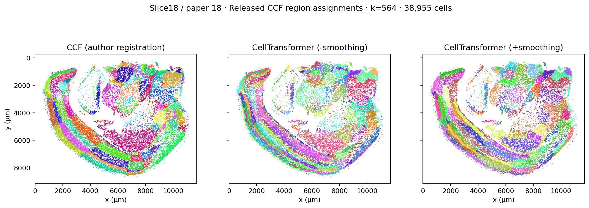

# CellTransformer2 — BARseq example

This repository packages the supplied **CellTransformer2** source with a complete
BARseq example that ran successfully on a Linux NVIDIA workstation. Starting from
public data, the example trains all model weights from random initialization for
10 full epochs, discovers spatial domains, compares them with the authors'
registered Allen CCF anatomy, and produces an offline HTML report and results ZIP.

**Start here: [barseq_example/README.md](barseq_example/README.md).**

```bash
# On the Linux GPU machine, from a clone of this repository:
BARSEQ_ROOT="$HOME/BARseq_CT2_example" bash barseq_example/launch_cactus.sh
```

The launcher installs its own environments and runs in the background. It needs
Linux x86_64, Python 3, curl, an NVIDIA GPU with bfloat16 support, a driver reporting
CUDA 12.2 or newer, and at least 80 GiB initially free. The demonstrated machine
used an RTX 6000 Ada GPU with approximately 48 GB VRAM and 128 GB system RAM.
Smaller hardware has not been validated.

## Demonstrated result

The completed run used **1,161,387 cells, 106 sequencing targets and 40 sections**
from one mouse hemisphere. It exported **1,161,154 embeddings** after 10 epochs
and **49,287 optimizer updates**. The matched reference resolutions contain
**63, 252 and 564 populated categories**.



Every anatomical reference label has its own display color, including cortical
layers; colors remain consistent across sections. Reference colors and model
cluster colors do not encode a correspondence.

See [real results and provenance](barseq_example/results/README.md) for training
curves, metrics, representative maps, software records and the limits of this
exploratory comparison. This example demonstrates an executable workflow; it is
not a claim of perfect anatomical recovery or independent-mouse generalization.

## Repository layout

```text
src/celltransformer/       Original model, loader, objectives and native tools
config/                   Original upstream Hydra configurations
tests/                    Original upstream tests and regression fixtures
barseq_example/           Dataset adapter, environments, launchers and report
  environment/            Dependency definitions and observed package records
  reference/              Small reference metadata and provenance
  results/                Selected outputs from the successful real run
  docs/                   Methods, troubleshooting and validation
provenance/upstream/      Original README and relocated tooling files
scripts/                 Maintainer manifest utility
```

All **66 supplied upstream files** are preserved byte for byte. The upstream
README, `.gitignore` and `.roborev.toml` are retained under `provenance/upstream/`
to allow this repository's landing page and ignore rules to describe the example.
The model source, configuration, license and upstream tests are unchanged.
[Source provenance](provenance/README.md) explains the audit and adapter boundary.

The root package is named `celltransformer`; “CellTransformer2” identifies the
supplied source version used here. The BARseq entry point is the example launcher,
which configures one GPU and finite epochs. The original native training CLI has
different machine-specific defaults and is not the BARseq quick-start command.

## Attribution

- CellTransformer2 source: Alex Lee; supplied MIT license retained in [LICENSE](LICENSE).
- Original CellTransformer study: [Data-driven fine-grained region discovery in the mouse brain with transformers](https://doi.org/10.1038/s41467-025-64259-4).
- BARseq: Chen, Fischer and colleagues, [Whole-cortex in situ sequencing reveals input-dependent area identity](https://doi.org/10.1038/s41586-024-07221-6).
- Public pilot dataset: [Mendeley Data, version 1](https://doi.org/10.17632/8bhhk7c5n9.1), CC BY 4.0.
- Anatomy: [Allen Mouse Brain Common Coordinate Framework](https://doi.org/10.1016/j.cell.2020.04.007).

This is an example distribution maintained for `ads303`, not a claim that the
CellTransformer2 model was authored by this example's maintainer. See
[THIRD_PARTY_NOTICES.md](THIRD_PARTY_NOTICES.md).
