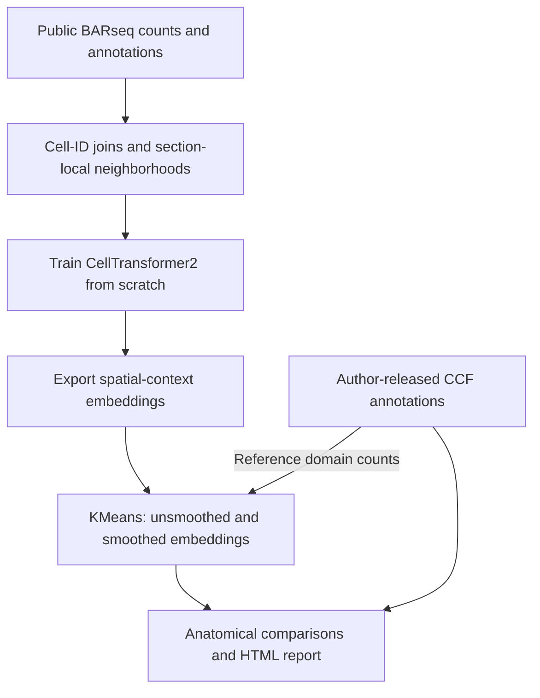

# CellTransformer2

**Spatial representation learning from single-cell gene expression and local tissue context.**

CellTransformer2 predicts a center cell's gene expression from neighboring cells
and their cell-type annotations. A transformer encoder learns the neighborhood
representation; a decoder predicts parameters of a Zero-Inflated Negative
Binomial (ZINB) distribution for the center cell. The learned representations can
then be clustered to identify spatial domains and compared with anatomical
annotations.

This repository contains the supplied CellTransformer2 source and a complete
[BARseq example](barseq_example/README.md): public data download, preparation,
training from scratch, embedding export, spatial smoothing, domain discovery,
anatomical comparison, and an offline HTML report. The demonstrated experiment
uses **1,161,387 cells, 106 sequencing targets and 40 sections from one mouse
hemisphere**, with a **10-epoch** training budget.

**For a first run, start with [Installation](#installation).** For the complete
operator guide, including remote report retrieval, see
[barseq_example/README.md](barseq_example/README.md).

---

## Table of contents

1. [Overview](#overview)
2. [Installation](#installation)
3. [Repository layout](#repository-layout)
4. [Configuration](#configuration)
5. [Scripts and entry points](#scripts-and-entry-points)
6. [Data format](#data-format)
7. [Model architecture](#model-architecture)
8. [Data loading pipeline](#data-loading-pipeline)
9. [Cell-type label encoding](#cell-type-label-encoding)
10. [Anatomical reference and comparison metrics](#anatomical-reference-and-comparison-metrics)
11. [Running and monitoring the BARseq example](#running-and-monitoring-the-barseq-example)
12. [Outputs and expected results](#outputs-and-expected-results)
13. [Validation and reproducibility](#validation-and-reproducibility)
14. [Adapting the workflow to another dataset](#adapting-the-workflow-to-another-dataset)
15. [Citations and license](#citations-and-license)

---

## Overview

The learning task is **masked-center expression prediction**. Each training
example contains a center cell and neighboring cells from the same tissue
section. The center's expression is withheld from the model input and supplies
the prediction target. Neighboring expression and cell types provide context;
the center's cell type conditions the decoder. Spatial coordinates determine
neighborhood membership.

The attention-pool output is a fixed-length spatial-context embedding. After
training, the example clusters these embeddings both before and after Gaussian
spatial smoothing. Anatomical labels supply an external comparison and the
number of requested domains at each reference resolution; they are not inputs
or targets for model training.



The BARseq example compares **CellTransformer (-smoothing)**,
**CellTransformer (+smoothing)** and **CCF (author registration)**. It implements
Figure 2-style spatial and composition analyses for this dataset. The reference
partitions, gene panel and biological cohort differ from the original
CellTransformer MERFISH study; CellCharter and SPIRAL are outside this example.

The native source lives in `src/celltransformer/`. Dataset preparation, finite
epochs on one GPU, run recovery and reporting live in `barseq_example/`.
[Methods and scope](barseq_example/docs/METHODS.md) documents the complete
experimental choices.

## Installation

### System requirements

| Component | Requirement or demonstrated configuration |
|---|---|
| Operating system | Linux x86_64 for the full pipeline |
| System tools | Python 3, Bash, curl, tar and standard GNU utilities; Git to clone the repository |
| GPU | NVIDIA GPU with bfloat16 support; demonstrated on an RTX 6000 Ada with approximately 48 GB VRAM |
| Driver | Must advertise CUDA 12.2 or newer in `nvidia-smi`; demonstrated with driver 535.309.01 |
| CPU and RAM | Demonstrated on an AMD Ryzen 9 7950X with 128 GB RAM |
| Storage | At least 80 GiB free initially; a 20-GiB reserve is checked between stages |
| Network | Access to GitHub, package channels, Mendeley Data and Allen reference downloads |

The demonstrated hardware is a reference configuration, not a measured minimum.
Smaller GPU or RAM configurations have not been validated. Initial planning
allowed 50–70 GiB for installation and one run; this is not a measured maximum.
The pinned data downloads themselves total **826,716,670 bytes**.

The installer creates its own micromamba and two environments within the
selected storage directory. Administrator privileges, a pre-existing conda
installation, MATLAB, pretrained weights and a Weights & Biases account are not
required. macOS and Windows can be used to access a remote Linux GPU workstation
and view its report; the complete training workflow is validated for Linux.

### Obtain the repository and launch the example

Run on the Linux GPU workstation, or within a GPU allocation on a managed cluster:

```bash
git clone https://github.com/ads303/celltransformer2-test.git
cd celltransformer2-test

# Check the unchanged source and example file manifests.
python3 barseq_example/source_layout.py

# Use a writable storage directory outside the source checkout.
export BARSEQ_ROOT="$HOME/BARseq_CT2_example"
export BARSEQ_GPU=0
export BARSEQ_EPOCHS=10

# Background execution on a workstation:
bash barseq_example/launch_cactus.sh
```

`launch_cactus.sh`, `status_cactus.sh` and `resume_cactus.sh` are existing helper
filenames. They can be used on any compatible Linux GPU host; no particular
hostname is required. Repository access is required while the repository is
private.

The launcher prints the process ID and log path, installs dependencies, downloads
the data, and executes all analysis stages. When launched over SSH, the job
continues after the client disconnects while the remote workstation remains
running. On a managed cluster, use the following foreground command inside an
allocated GPU job, following the local scheduler's submission procedure:

```bash
bash barseq_example/run_all.sh --root "$BARSEQ_ROOT" --epochs 10
```

### Dependency environments

| Environment | Purpose | Principal versions |
|---|---|---|
| `envs/celltransformer2-v1` | Preparation, training, export, smoothing, metrics and reporting | Python 3.11, PyTorch 2.5.1+cu121, Lightning 2.4.0, torchdata 0.10.1, NumPy 1.26.4, SciPy 1.14.1 |
| `envs/rapids-24.12` | Native GPU KMeans | cuML/cuDF 24.12, CUDA environment 12.2 |

The supported BARseq installation path is the launcher. It imports the audited
source directly; a separate `pip install -e .` is not needed to run the example.
Direct requirements, constraints from the successful training environment, and
RAPIDS compatibility pins are in [barseq_example/environment/](barseq_example/environment/README.md).
The RAPIDS definition is not an exact historical conda build lock.

The launcher sets `CUBLAS_WORKSPACE_CONFIG=:4096:8` before Python starts and
verifies driver capability before setting the RAPIDS solver's CUDA metadata.
The environments contain their runtime dependencies; the installer does not
replace the system NVIDIA driver.

## Repository layout

```text
celltransformer2-test/
├── src/celltransformer/       Native CellTransformer2 package
│   ├── model/                SpatialCellTransformer and component layers
│   ├── loader/               Neighborhood metadata, sampling and batching
│   ├── distributions/        Negative Binomial and ZINB distributions
│   ├── train/                Lightning training module and scheduler
│   ├── extract/              Spatial-context embedding extraction
│   ├── infer/                Native inference utilities
│   ├── preprocess/           Section preparation utilities
│   ├── cluster/              GPU KMeans utilities
│   ├── smooth/               Gaussian smoothing utilities
│   └── profile/              Cell-type composition utilities
├── config/                   Original native Hydra configurations
├── tests/                    Original upstream tests and fixtures
├── barseq_example/
│   ├── pipeline.py           Stage execution, configuration and run snapshots
│   ├── prepare_barseq.py     Downloads, cell-ID joins and neighborhoods
│   ├── data_ct2.py           Cached dataset and finite-epoch sampler
│   ├── train_ct2.py          Single-GPU training, recovery and export
│   ├── analyze.py            Smoothing and anatomical comparison metrics
│   ├── cluster.py            Native KMeans on both embedding variants
│   ├── report.py             Standalone HTML, figures and results ZIP
│   ├── environment/          Dependency definitions and package records
│   ├── reference/            Small reference metadata and provenance
│   ├── results/              Selected outputs from the completed experiment
│   └── docs/                 Methods, validation and troubleshooting
├── provenance/               Original source manifest explanation and README
├── scripts/                  Example-manifest maintenance utility
├── .github/workflows/        Automated source and CPU checks
├── pyproject.toml            Native package metadata and console entry points
└── LICENSE                   Original CellTransformer2 license
```

All **66 supplied upstream files** are preserved byte for byte. The original
README, `.gitignore` and `.roborev.toml` are retained under
`provenance/upstream/`; the source, configurations, tests and license remain at
their original relative paths. See [source provenance](provenance/README.md).

## Configuration

### BARseq run configuration

Every new run writes `config.json` and copies the source and adapters into
`runner_snapshot/`. Preparation determines the expression dimension and cell-type
cardinality from the selected genes and vocabulary. The saved configuration is
the record of the values actually used.

The launch helpers expose these settings:

| Setting | Default | Purpose |
|---|---|---|
| `BARSEQ_ROOT` | `$HOME/BARseq_CT2_example` | Data, environments, logs and run outputs |
| `BARSEQ_GPU` | `0` | GPU selected through `CUDA_VISIBLE_DEVICES` |
| `BARSEQ_EPOCHS` | `10` | Full epochs requested by the background launcher |
| `run_all.sh --epochs` | `10` | Full epochs for foreground execution |

The following scientific defaults are defined in
[pipeline.py](barseq_example/pipeline.py) and recorded in each run:

| Group | Demonstrated settings |
|---|---|
| Neighborhood | 310 × 310 µm square; same section; center excluded |
| Input transform | `log2(raw molecule counts + 1)`; float32 model input |
| Model | 106 expression channels, 46 cell types, width 384, 4 encoder layers, 4 decoder layers, 8 heads, FFN dimension 384 |
| Model options | Additive expression/type embedding, diagonal normalization, ZINB, dropout 0, compilation disabled |
| Optimization | Learning rate 0.0003, weight decay 1e-8, warmup 500 updates, scheduler timescale 5,000 updates |
| Batching | Maximum 256 centers and 16,384 tokens per batch; gradient accumulation 1 |
| Execution | One GPU, bfloat16 mixed precision, seed 42, deterministic training, 0 DataLoader workers, 8 CPU math threads |
| Validation | 5% of eligible centers within each section |
| Export | Final completed epoch checkpoint; float32 forward execution and 384-dimensional embeddings |
| Smoothing | Gaussian sigma 100 µm; up to 500 same-section neighbors, including self |
| Clustering | Native cuML KMeans; seed 42; `n_init=5`; reference-matched k values |

Ten epochs mean ten visits to every eligible training center, with the final
incomplete batch retained. They do not mean ten optimizer updates. Batch sizes
vary with neighborhood size; the demonstrated run completed 49,287 updates.

### Native package configuration

The original training entry point uses Hydra YAML files in `config/`, with
`data`, `model` and `optimization` groups. Those YAML files do **not** configure
the BARseq launcher, which constructs and saves its own run configuration while
using the native model and training components.

For a reviewed change to scientific defaults, edit the example adapter before
starting a new run, refresh its manifest with
`python3 scripts/update_example_manifest.py`, and rerun the relevant checks.
Existing runs resume from their own saved configuration and source snapshot.
Changing a shell variable does not redefine an existing experiment.

## Scripts and entry points

### BARseq workflow

| Script | Role |
|---|---|
| `launch_cactus.sh` | Start the complete workflow in the background |
| `run_all.sh` | Run the complete workflow in the foreground or a scheduled GPU job |
| `status_cactus.sh` | Show the latest run's stages and recorded process status |
| `resume_cactus.sh` | Resume an existing run from its saved snapshot |
| `setup_environment.sh` | Install and check both environments; invoked by the workflow |
| `source_layout.py` | Audit the original source and example manifests |

The workflow runs seven stages in order: **environment → prepare → train →
smooth → cluster → metrics → report**. Training includes final-checkpoint
embedding export. Each stage has its own log and required outputs.

### Native package tools

The supplied `pyproject.toml` declares six console entry points. They are useful
for developers adapting the package and are separate from the BARseq run manager.

| Entry point | Function |
|---|---|
| `celltransformer-train` | Hydra-based native training |
| `celltransformer-extract` | Attention-pool embedding extraction |
| `celltransformer-preprocess` | Section data preparation |
| `celltransformer-cluster` | GPU KMeans and spatial plots |
| `celltransformer-smooth` | Gaussian embedding smoothing |
| `celltransformer-profile` | Cell-type composition profiles |

The original training launcher has machine-specific multi-GPU and logging
defaults. The BARseq adapter supplies the demonstrated single-GPU execution and
section-safe smoothing path. Use the example launchers to reproduce this case;
the [preserved upstream README](provenance/upstream/README.md) documents the
native interface as supplied.

## Data format

### Released BARseq inputs

The input is the public pilot hemisphere from Chen, Fischer and colleagues,
[Mendeley Data version 1](https://doi.org/10.17632/8bhhk7c5n9.1).
[DOWNLOAD_MANIFEST.json](barseq_example/DOWNLOAD_MANIFEST.json) records the URLs,
sizes and SHA256 checksums for the processed count matrix, type-label table,
registered-cell table and Allen annotation volume.

Cell identity is established by numeric cell IDs, not file row order. The released
matrix has 2,167,762 cells; 1,161,387 match the authors' published QC/type-label
table. The 97,869 label IDs without released count rows are inventoried. All 208
retained cells labelled `Low Quality` remain flagged in the metadata.

The model uses 106 named sequencing targets after excluding five unused columns
and three separate hybridization channels. The paper describes a 104-gene panel;
the released matrix and author panel inventories differ. Both inventories and
the explicit selection are retained. No library-size normalization, count
rounding or highly variable gene selection is applied.

### Prepared example data

| Artifact under `prepared/` | Contents |
|---|---|
| `counts.npy`, `genes.json` | Raw int32 molecule counts and ordered gene names |
| `cells.parquet` | Cell IDs, sections, coordinates, published types, reference labels and QC fields |
| `xy_um.npy`, `sections.npy`, `types.npy` | Coordinates in micrometers, section codes and model type codes |
| `vocabulary.json` | Ordered section, cell-type and reference category dictionaries |
| `neighbor_indptr.npy`, `neighbor_indices.npy` | Cached section-local neighborhoods |
| `eligible.npy`, `train_ids.npy`, `validation_ids.npy` | Usable-center mask and split indices |
| `reference_*.npy`, `references.json` | Reference assignments and ontology metadata |
| `summary.json`, `section_inventory.tsv` | Cohort, graph and section-level inventories |

All full-length cell arrays use the row order of `cells.parquet`. Preserve this
alignment when consuming the outputs. Embedding rows for ineligible centers are
`NaN`, and corresponding model-domain labels are `-1`; use `eligible.npy` rather
than assuming every retained cell was embedded.

### Native loader format

The native section loader expects paired `.h5ad` and `.parquet` files with
aligned rows. Expression is float32 `log2(1 + counts)`; metadata provides spatial
coordinates, a section identifier and a cell-type column. The BARseq adapter
creates cached arrays directly from the public files and checks sampled
neighborhood tensors against this native loader before training. Users do not
need to create AnnData files manually for the example.

## Model architecture

```text
Neighbor expression + neighbor cell types
                 │
                 ▼
       CellEmbedder → model width 384
                 │
                 ▼
       Transformer encoder × 4
       (variable-length neighborhood tokens)
                 │
                 ▼
       AttentionPool → spatial-context embedding ──► Export for domain discovery
                 │
                 ├── center cell-type embedding
                 ▼
       Transformer decoder × 4
       (context token + center-type token)
                 │
                 ▼
       Center prediction token → ZINB projection
                 │
                 ▼
       Negative log likelihood of center counts
```

The example adds the expression and type embeddings, uses learnable per-gene
diagonal normalization, and packs variable-length neighborhoods with PyTorch
nested jagged tensors. Attention pooling returns one vector per center. The
decoder processes a two-token sequence and uses the center prediction token for
the ZINB parameter projection.

The native loss converts log2-transformed targets back to count scale with
`2**x - 1` before evaluating the ZINB log probability. All model parameters are
randomly initialized and trained; no pretrained checkpoint is loaded. The
exported representation is the attention-pool context vector, before the
center-type-conditioned decoder.

## Data loading pipeline

### Neighborhood construction

The adapter uses the authors' corrected two-dimensional physical coordinates,
not atlas-warped coordinates, to construct a 310 × 310 µm square around each
center. It retains nonempty cells from the same section and removes the center
itself. Cached neighbor indices preserve the ordering used by the native loader.
The demonstrated graph contains 83,621,664 edges, with a median of 70 neighbors
per eligible center. Of the retained cells, 233 lack usable spatial context.

### Token-budget batching and finite epochs

The native `BudgetBatcher` assigns each sample a token cost of
`number_of_neighbors + 1`. It groups samples subject to both the center-count
and token-count limits. The adapter shuffles center indices for each epoch,
computes the finite number of batches, and retains the final short batch.

Neighborhood arrays are memory-mapped. Raw counts are transformed to float32
`log2(count + 1)` when a sample is loaded, then passed through the unchanged
native Lightning module, loss, optimizer and scheduler. This path uses one GPU;
the native distributed file sharding and DDP epoch-length synchronization are
not part of the BARseq workflow.

### Training and validation split

The example samples validation centers within each section, giving 1,103,095
training centers and 58,059 validation centers. Context neighborhoods can overlap,
and validation centers can appear as neighbors of training centers. Validation
therefore measures center prediction with shared spatial context. It does not
establish generalization to an independent section, animal or experiment.

## Cell-type label encoding

The authors' expression-derived subclass labels define 46 input categories.
Missing subclass labels fall back to the published class label; the analogous
rule supplies missing cluster-level composition labels. The adapter sorts the
category names, stores the vocabulary, and encodes labels as contiguous integer
indices. The model's cell-type cardinality is updated from that vocabulary.

These codes are distinct from anatomical CCF IDs. Published cell types are used
both as model inputs and for downstream composition comparisons, so composition
correlation is not an independent validation of those input annotations. Preserve
the gene order and type vocabulary with every checkpoint and embedding export.

## Anatomical reference and comparison metrics

### Reference resolutions

The primary reference is the anatomical name assigned to each cell in the
authors' `neurons_registered.csv`, joined by cell ID and mapped by exact name to
the Allen ontology. The CSV's palette index is not a structure ID. A separate
lookup in the 25-µm Allen CCF volume audits the released assignments without
replacing them.

| Reference partition | Definition | Populated categories in the demonstrated evaluation |
|---|---|---:|
| `depth5` | Ancestor at ontology depth 5, with root at depth 1 | 63 |
| `depth7` | Ancestor at ontology depth 7 | 252 |
| `released` | Finest populated author-released assignments | 564 |

Internal-node labels represent residual assignments, and some labels identify
non-grey-matter structures. These partitions are not the original MERFISH
paper's 25/354/670 division, structure and substructure cuts. KMeans is fitted to
all eligible embeddings; comparisons use the same 1,149,888 eligible,
reference-labelled cells for both CT2 variants.

### Figure 2-style comparisons

| Measure | Calculation in this example |
|---|---|
| Neighborhood spatial similarity | Mean cell-level fraction of up to 100 nearest same-section evaluation neighbors sharing the label; self excluded |
| Proportion of discrete domains | Fraction of requested domains whose mean spatial similarity reaches the reference-domain 20th percentile; missing domains count as failures |
| Max. domain CCF similarity | Mean over defined model domains of the maximum Pearson correlation with reference-region subclass composition |
| Matched domain CCF similarity | Mean Pearson correlation under a maximum-sum one-to-one assignment, reported only for complete equal-sized matching |
| Region-by-domain matrix | Pearson correlations of subclass composition vectors |
| Cell-type composition matrices | Cluster-level composition, with each region/domain row normalized to sum to 1 |

Detailed definitions and matching records accompany the numeric results. All
reference labels, including cortical layers, receive distinct display colors
consistent across sections. Model and reference colors are assigned independently;
equal colors do not imply a matched domain. Plotted boundaries are approximate
outlines derived from observed cell labels, not the original atlas polygons.

## Running and monitoring the BARseq example

### Follow progress

From the repository root on the GPU host, keep `BARSEQ_ROOT` set to the storage
directory used at launch:

```bash
export BARSEQ_ROOT="$HOME/BARseq_CT2_example"
bash barseq_example/status_cactus.sh

BARSEQ_RUN=$(cat "$BARSEQ_ROOT/LATEST_BARSEQ_CT2")
cat "$BARSEQ_RUN/status.json"
tail -n 30 -F "$BARSEQ_RUN/logs/train.log"
```

`Ctrl+C` stops following the log without stopping the job. Inspect
`logs/environment.log` or `logs/prepare.log` if training has not started. Training
logs report center throughput and a training-time estimate; later analysis and
reporting stages add time. A measured total runtime benchmark across machines is
not available.

### Stop and resume

To stop, first confirm that the recorded PID is the intended pipeline:

```bash
BARSEQ_PID=$(cat "$BARSEQ_RUN/PID")
ps -p "$BARSEQ_PID" -o pid,etime,args
# After checking the process above:
kill -TERM "$BARSEQ_PID"
```

Resume that run with:

```bash
bash barseq_example/resume_cactus.sh "$BARSEQ_RUN"
```

Environment checks run again; completed stages with valid recorded artifacts are
reused. Training restores the last completed-epoch checkpoint. An interrupted
partial epoch is repeated, with later partial history rolled back. Completed
data and checkpoints remain in the storage directory.

### Confirm completion and retrieve the report

The full workflow is complete when `status.json` reports `overall: PASSED`, the
run has a `SUCCESS` marker, and both report files exist:

```bash
cat "$BARSEQ_RUN/status.json"
cat "$BARSEQ_RUN/SUCCESS"
ls -lh "$BARSEQ_RUN/report/review.html" "$BARSEQ_RUN/report/results.zip"
```

Open `review.html` in a browser on the workstation, or follow the
[remote retrieval instructions](barseq_example/README.md#retrieve-and-open-the-report-on-your-local-computer)
to copy the HTML and ZIP to a local computer. Images are embedded, so the report
works offline. A training success message alone does not mean the report is ready.

For dependency, storage, GPU and recovery issues, see
[Troubleshooting](barseq_example/docs/TROUBLESHOOTING.md). Failed stages record
their cause and log path in `status.json`.

## Outputs and expected results

### Run outputs

Each run is stored under `$BARSEQ_ROOT/runs/<run-id>/`:

| Output | Purpose |
|---|---|
| `config.json`, `environment.json` | Scientific settings and observed training environment |
| `runner_snapshot/`, `stage_manifests/` | Executed source and stage output records |
| `prepared/` | Aligned data, vocabularies, neighborhoods and split indices |
| `celltransformer/checkpoints/` | Completed-epoch model and optimizer checkpoints |
| `celltransformer/epochs.json`, `celltransformer/train_hist.csv` | Epoch summaries and per-update history |
| `celltransformer/embeddings.npy` | Row-aligned, 384-dimensional spatial-context representations |
| `analysis/smoothed.npy`, `analysis/labels/` | Smoothed embeddings and both variants' domain labels |
| `analysis/metrics/` | Figure 2-style metrics, compositions, correlations and assignments |
| `report/review.html` | Interactive section selection, spatial maps, diagnostics and comparisons |
| `report/results.zip` | HTML, figures, tables, configuration, source manifests and software records |
| `logs/`, `status.json`, `SUCCESS` | Stage diagnostics and completion state |

The HTML includes all 40 sections at three reference resolutions, cortical
enlargements, training curves, comparison plots and composition matrices. The
full HTML and ZIP can be hundreds of megabytes. Large input arrays, embeddings
and checkpoints stay in the run directory and are not committed to Git.

### Demonstrated experiment

Selected outputs from the completed GPU run are included in
[barseq_example/results/](barseq_example/results/README.md), with provenance
records identifying their source files and transformations.

| Observation | Recorded value |
|---|---:|
| Completed epochs | 10 |
| Optimizer updates | 49,287 |
| Exported centers | 1,161,154 |
| Final training NLL | 0.653343 |
| Final validation NLL | 0.666628 |
| Lowest validation NLL | 0.664303 at epoch 6 |


The exported checkpoint is the final completed epoch. Validation loss reached
its minimum earlier, so this example does not establish that ten epochs is the
optimal stopping point. The recorded values provide a reference for inspecting
a run, not a guarantee of identical results on other software builds or hardware.


At k=564, the unsmoothed result has 561 populated domains on the common evaluation
mask, although all 564 clusters are populated across eligible cells. Its complete
one-to-one matched score is therefore undefined and remains blank in the output.
The report preserves this distinction rather than presenting an incomplete
assignment as a full match. The smoothed result has complete matching at this
resolution; detailed values are in the [recorded results](barseq_example/results/README.md).

## Validation and reproducibility

### What is validated

The original BARseq GPU experiment completed training, export, smoothing,
clustering, metrics and report generation. The repository assembly additionally
passes source-integrity checks, 41 upstream CPU tests, three packaging tests,
BARseq data-join checks, and a synthetic adapter test covering finite epochs,
checkpoint recovery, smoothing, matching and HTML/ZIP generation. These software
checks run in [GitHub Actions](https://github.com/ads303/celltransformer2-test/actions).

The CPU orchestration fixture uses an explicitly labelled toy forward model
with the native loss, optimizer and scheduler. Production uses the native CUDA
model and requires successful forward/backward, batch-isolation, center-masking
and gradient checks. The new repository packaging has not received a second
complete 10-epoch GPU run on an independent machine. See the
[validation record](barseq_example/docs/VALIDATION.md) for this distinction and
commands to rerun the CPU checks.

### Records to retain for a publication

Record the exact repository commit (`git rev-parse HEAD`), run ID, configuration,
source manifests, data accession/version, software records, hardware and
checkpoint hash. Preserve the gene order, type vocabulary, split indices and
reference dictionary alongside the numerical outputs. Each run snapshots the
source it executes, so later documentation or code updates do not redefine it.

The supplied native directory had no Git history. Its 66-file SHA256 manifest
identifies the source used here; no upstream release tag or commit is inferred.
New runs export explicit conda package records as well as pip freezes. The
original successful run's exact transitive conda build list was not captured;
the available dependency evidence is described in the
[environment documentation](barseq_example/environment/README.md).

This is an exploratory analysis of one mouse hemisphere. Anatomy is excluded
from model training, but reference labels determine comparison resolutions, and
expression-derived type annotations also enter composition metrics. Claims about
independent biological generalization require a separate experimental design.

## Adapting the workflow to another dataset

The example is specific to the pinned BARseq release, including cell-ID checks,
gene selection and anatomical joins. Applying the native model to another
dataset requires an explicit adapter and appropriate evaluation design.

1. Establish stable cell identities, gene order, raw-count semantics and a
   cell-type vocabulary. Keep count rows and metadata aligned.
2. Verify physical coordinate units and section boundaries before choosing the
   neighborhood dimensions and smoothing scale.
3. Set the expression dimension and type cardinality to the new data, and decide
   whether evaluation requires held-out sections, animals or experiments.
4. Define anatomical label provenance, available reference resolutions and a
   shared evaluation mask. Use only labels present in that dataset.
5. Audit the adapter against native loader tensors, run software and GPU checks,
   and preserve a separate configuration, source snapshot and output directory.

The BARseq settings are a demonstrated starting point for this dataset, not
universal hyperparameters. Follow the native data contract and document changes
to neighborhoods, targets, annotations, training budget and comparisons.

## Citations and license

When using this workflow, cite the method, the underlying data and the anatomical
reference, and identify the software commit and source manifest used:

- **CellTransformer:** [Data-driven fine-grained region discovery in the mouse brain with transformers](https://doi.org/10.1038/s41467-025-64259-4).
- **BARseq study:** Chen, Fischer and colleagues, [Whole-cortex in situ sequencing reveals input-dependent area identity](https://doi.org/10.1038/s41586-024-07221-6).
- **BARseq pilot data:** [Mendeley Data, version 1, 8bhhk7c5n9](https://doi.org/10.17632/8bhhk7c5n9.1).
- **Anatomy:** [Allen Mouse Brain Common Coordinate Framework](https://doi.org/10.1016/j.cell.2020.04.007).

The supplied CellTransformer2 code is authored by Alex Lee and retains its
original [MIT license](LICENSE). The BARseq adapter is distributed under its
[MIT license](barseq_example/LICENSE). The BARseq deposit and selected derived
results use CC BY 4.0; external data and dependencies retain their respective
terms. See [THIRD_PARTY_NOTICES.md](THIRD_PARTY_NOTICES.md) for attribution and
distribution scope.

“CellTransformer2” identifies the supplied source version; the Python package is
named `celltransformer`. This repository packages that model with a documented
example and preserves its original authorship.
