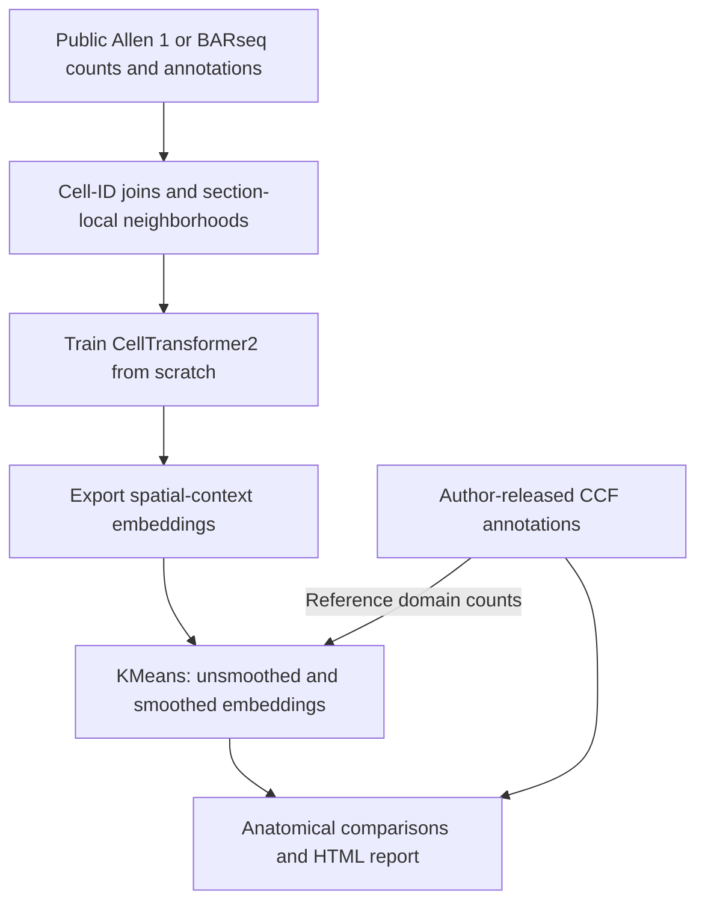
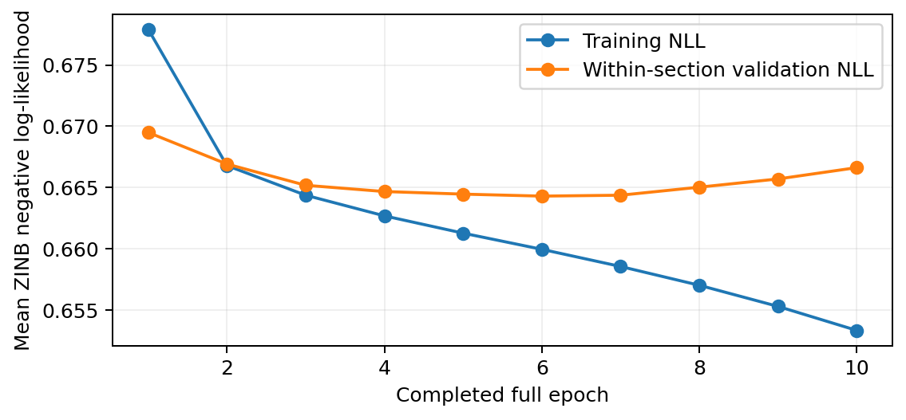

# CellTransformer2

**Spatial representation learning from single-cell gene expression and local tissue context.**

CellTransformer2 predicts a center cell's gene expression from neighboring cells
and their cell-type annotations. A transformer encoder learns the neighborhood
representation; a decoder predicts parameters of a Zero-Inflated Negative
Binomial (ZINB) distribution for the center cell. The learned representations can
then be clustered to identify spatial domains and compared with anatomical
annotations.

This repository packages the supplied CellTransformer2 source with two complete
examples: public data download, preparation, training from scratch, embedding
export, spatial smoothing, domain discovery, anatomical comparison and an
offline HTML report. **Allen 1 is the primary example** because it is the primary
dataset analyzed in the original CellTransformer paper. **BARseq is a second
worked example** on an independently generated spatial dataset.

| Example | Data used by the adapter | Reference resolutions | Guide |
|---|---|---|---|
| **Allen 1 MERFISH — primary** | 3,739,961 released annotated cells, 500 measured genes, 53 coronal sections | CCF division / structure / substructure: **25 / 354 / 670** | [Allen guide](allen_example/README.md) |
| **BARseq — secondary** | 1,161,387 cells, 106 sequencing targets, 40 sections from one mouse hemisphere | Two ontology cuts and released labels: **63 / 252 / 564** | [BARseq guide](barseq_example/README.md) |

Both default to **10 full epochs** with random initialization and all weights
trained. The Allen workflow uses **CellTransformer2 on the original paper's
primary dataset**; it is not a claim to reproduce the original CT1 model's
numerical results. Its public annotation inventory also differs slightly from
the paper's reported cell total, as detailed below.

**For a first run, start with [Installation](#installation).** Both examples can
also run through [pip-installed commands](#pip-installation). Detailed operating,
recovery and report-retrieval instructions are in the individual guides.

---

## Table of contents

1. [Overview](#overview)
2. [Installation](#installation)
3. [Repository layout](#repository-layout)
4. [Configuration](#configuration)
5. [Scripts and entry points](#scripts-and-entry-points)
6. [Data format](#data-format)
7. [Model architecture](#model-architecture)
8. [Data loading pipeline](#data-loading-pipeline)
9. [Cell-type label encoding](#cell-type-label-encoding)
10. [Anatomical reference and comparison metrics](#anatomical-reference-and-comparison-metrics)
11. [Running and monitoring the examples](#running-and-monitoring-the-examples)
12. [Outputs and expected results](#outputs-and-expected-results)
13. [Validation and reproducibility](#validation-and-reproducibility)
14. [Adapting the workflow to another dataset](#adapting-the-workflow-to-another-dataset)
15. [Citations and license](#citations-and-license)

---

## Overview

The learning task is **masked-center expression prediction**. Each training
example contains a center cell and neighboring cells from the same tissue
section. The center's expression is withheld from the model input and supplies
the prediction target. Neighboring expression and cell types provide context;
the center's cell type conditions the decoder. Spatial coordinates determine
neighborhood membership.

The attention-pool output is a fixed-length spatial-context embedding. After
training, each example clusters these embeddings both before and after Gaussian
spatial smoothing. Anatomical labels supply an external comparison and the
number of requested domains at each reference resolution; they are not inputs
or targets for model training.



Both examples compare **CellTransformer (-smoothing)** and **CellTransformer
(+smoothing)** with the released **CCF reference**. They produce Figure 2-style
spatial and cell-type composition analyses. CellCharter, SPIRAL and other model
baselines are not included in either example.

The native source lives in `src/celltransformer/`. Dataset-specific preparation,
finite epochs on one GPU, run recovery and reporting live in `allen_example/`
and `barseq_example/`. Each saves its own settings, vocabulary, run snapshot and
outputs. See the [Allen settings](allen_example/README.md#training-and-comparison-settings)
and [BARseq methods](barseq_example/docs/METHODS.md) for the experimental choices.

## Installation

### System requirements

| Component | Requirement or demonstrated configuration |
|---|---|
| Operating system | Linux x86_64; reported workstation: **Ubuntu 22.04.5 LTS**, kernel **5.15.0-190-generic** |
| System tools | Python 3, Bash, curl, tar and standard GNU utilities; Git to clone the repository |
| GPU | NVIDIA GPU with bfloat16 support; demonstrated on an RTX 6000 Ada with approximately 48 GB VRAM |
| Driver | Must advertise CUDA 12.2 or newer in `nvidia-smi`; demonstrated with driver 535.309.01 |
| CPU and RAM | Demonstrated on an AMD Ryzen 9 7950X with 128 GB RAM |
| Storage | At least 80 GiB free initially; a 20-GiB reserve is checked between stages |
| Network | Access to GitHub, package channels, Mendeley Data and Allen reference downloads |

The demonstrated hardware is a reference configuration, not a measured minimum.
Smaller GPU or RAM configurations have not been validated. Initial planning
allowed 50–70 GiB for installation and one run; this is not a measured maximum.
Pinned downloads total **9,265,218,578 bytes (9.27 GB)** for Allen and
**826,716,670 bytes (0.83 GB)** for BARseq. Download size excludes environments,
prepared arrays, embeddings, checkpoints and reports. The OS record describes
the user's workstation; the exact patch release and kernel are not minimum requirements.

The installer creates its own micromamba and two environments within the
selected storage directory. Administrator privileges, a pre-existing conda
installation, MATLAB, pretrained weights and a Weights & Biases account are not
required. macOS and Windows can be used to access a remote Linux GPU workstation
and view its report; the complete training workflow targets Linux.

### Obtain the repository and launch Allen 1

Run on the Linux GPU workstation, or within a GPU allocation on a managed cluster:

```bash
git clone https://github.com/ads303/celltransformer2-test.git
cd celltransformer2-test

# Verify the native source and primary example manifests.
python3 allen_example/source_layout.py

# Keep data and run outputs outside the source checkout.
export ALLEN_ROOT="$HOME/Allen1_CellTransformer2"
export ALLEN_GPU=0
export ALLEN_EPOCHS=10
bash allen_example/launch.sh
```

Repository access is required while the repository is private. The launcher
prints the PID and log path, installs/checks dependencies, downloads the data and
executes all analysis stages. An SSH-launched background job continues after the
client disconnects while the GPU workstation remains running.

To run the secondary BARseq example instead:

```bash
python3 barseq_example/source_layout.py
export BARSEQ_ROOT="$HOME/BARseq_CT2_example"
export BARSEQ_GPU=0
export BARSEQ_EPOCHS=10
bash barseq_example/launch_cactus.sh
```

BARseq retains the existing filenames `launch_cactus.sh`, `status_cactus.sh` and
`resume_cactus.sh` for compatibility. They work on any compatible Linux GPU host.
The two storage roots are separate; neither example loads the other's weights.

On a managed cluster, use a foreground command inside an allocated GPU job:

```bash
bash allen_example/run_all.sh --root "$ALLEN_ROOT" --epochs 10
# Or: bash barseq_example/run_all.sh --root "$BARSEQ_ROOT" --epochs 10
```

Allen can reuse compatible existing training and RAPIDS environments without
modifying them. See the [Allen environment options](allen_example/README.md#launch).

### Pip installation

The repository also builds an installable Python distribution,
**`celltransformer2-test`**, with `celltransformer-allen` and `celltransformer-barseq` commands and the
native `celltransformer` import package. Use a fresh **Python 3.11** environment.
On a Linux GPU workstation, from a clone:

```bash
python3.11 -m venv "$HOME/.venvs/celltransformer2"
source "$HOME/.venvs/celltransformer2/bin/activate"
python -m pip install --upgrade pip
python -m pip install 'torch==2.5.1' --index-url https://download.pytorch.org/whl/cu121
python -m pip install .

celltransformer-allen audit
celltransformer-allen run --root "$HOME/Allen1_CellTransformer2" --epochs 10 --gpu 0 --background

# Secondary example:
# celltransformer-barseq run --root "$HOME/BARseq_CT2_example" --epochs 10 --gpu 0 --background
```

Each installed command includes its example scripts and audited source needed to
run from any directory. The workflow still creates its demonstrated training
and RAPIDS environments under the selected storage root; pip alone does not
install the NVIDIA driver or start an experiment. The existing checkout/Bash
workflow remains available.

See [Pip installation and builds](docs/PIP_INSTALLATION.md) for
direct GitHub installation, wheels, source archives, editable installs and the
installed native tools. The distribution has not been published to PyPI.

### Dependency environments

| Environment | Purpose | Principal versions |
|---|---|---|
| `envs/celltransformer2-v1` | Preparation, training, export, smoothing, metrics and reporting | Python 3.11, PyTorch 2.5.1+cu121, Lightning 2.4.0, torchdata 0.11.0, NumPy 1.26.4, SciPy 1.14.1 |
| `envs/rapids-24.12` | Native GPU KMeans | cuML/cuDF 24.12, CUDA environment 12.2 |

Both example launchers import the audited source directly. A pip installation is
optional for the checkout workflow and supplies console commands for installed use.
Direct requirements, constraints from the successful training environment, and
RAPIDS compatibility pins are in the [Allen](allen_example/environment/README.md)
and [BARseq](barseq_example/environment/README.md) environment directories.
The RAPIDS definition is not an exact historical conda build lock.

The launcher sets `CUBLAS_WORKSPACE_CONFIG=:4096:8` before Python starts and
verifies driver capability before setting the RAPIDS solver's CUDA metadata.
The environments contain their runtime dependencies; the installer does not
replace the system NVIDIA driver.

### Environments for the notebooks

> **Not yet tested from scratch.** These commands were reconstructed from the
> working environments on the development workstation. Run them in a clean
> account and confirm the checks below before relying on them.

The notebooks in `notebooks/` (`01_allen_dataset.ipynb` and
`02_custom_dataset.ipynb`) use two conda environments that you create
yourself. They are separate from the environments the launchers above build.

| Environment | Used for |
|---|---|
| `celltransformer2-dev` | The notebooks' Jupyter kernel: data preparation, training and embedding export |
| `celltransformer2-rapids` | Smoothing and clustering on the GPU with cuML (`celltransformer-smooth`, `celltransformer-cluster`) |

Two environments are needed because cuDF 24.12 requires pyarrow older than
19, while this package pins pyarrow 19.0.1.

**Before you start**

1. Check the GPU driver. Run `nvidia-smi`; the `CUDA Version` shown in the top
   right must be 12.2 or newer.
2. Install conda. We recommend [Miniforge](https://github.com/conda-forge/miniforge),
   which uses the free conda-forge channel by default. (Anaconda's default
   channel may require a paid license at larger institutions.)
3. Clone the repository and run all commands below from its top-level directory:

   ```bash
   git clone https://github.com/ads303/celltransformer2-test.git
   cd celltransformer2-test
   ```

**1. Create `celltransformer2-dev`**

```bash
conda create -y -n celltransformer2-dev -c conda-forge python=3.11 pip
conda activate celltransformer2-dev

# PyTorch first, from PyTorch's own index, so pip gets the CUDA 12.1 build
pip install torch==2.5.1 --index-url https://download.pytorch.org/whl/cu121

# this package and its pinned requirements
pip install -e .

# register the environment as a Jupyter kernel
pip install ipykernel
python -m ipykernel install --user --name celltransformer2-dev --display-name celltransformer2-dev
```

Check the installation:

```bash
python -c "import torch, torchdata; print(torch.__version__, torchdata.__version__, torch.cuda.is_available())"
```

The expected output is `2.5.1+cu121 0.11.0 True`.

**2. Create `celltransformer2-rapids`**

```bash
conda create -y -n celltransformer2-rapids --override-channels -c rapidsai -c conda-forge -c nvidia \
    python=3.11 cuml=24.12 cudf=24.12 cuda-version=12.2 numpy=1.26.4 scipy=1.14.1 \
    numba=0.60.0 numba-cuda=0.0.17.1 pynvjitlink=0.4.0 pip
conda activate celltransformer2-rapids

pip install torch==2.5.1 --index-url https://download.pytorch.org/whl/cu121

# the package's requirements, except pyarrow, which must stay at the version cuDF installed
pip install $(grep -v '^pyarrow==' barseq_example/requirements.txt) -r packaging_requirements.txt

# the package itself, without letting pip change any dependencies
pip install --no-deps -e .
```

> **Do not run `pip install -e .` without `--no-deps` in this environment.** It
> upgrades pyarrow to 19.0.1, and cuDF stops working.

Check the installation:

```bash
python -c "import cuml, pyarrow; print(cuml.__version__, pyarrow.__version__)"
celltransformer-smooth --help
```

cuML should report 24.12 and pyarrow a version older than 19 (17.0.0 on the
development workstation). `pip check` in this environment lists several cuML and
cuDF dependencies as missing, plus pyarrow and click version mismatches. This is
expected: conda installs those dependencies under names pip does not recognize,
and the version differences are deliberate.

**3. Point the notebooks at the environments**

- In Jupyter or VS Code, select the `celltransformer2-dev` kernel. The notebooks
  find the development environment from the running kernel.
- Set `RAPIDS_BIN` in the configuration cell near the top of each notebook to the `bin/`
  directory of `celltransformer2-rapids`. To find it, run `conda env list` and add
  `/bin` to the path shown for `celltransformer2-rapids`, for example
  `/home/<user>/miniforge3/envs/celltransformer2-rapids/bin`.

## Repository layout

```text
celltransformer2-test/
├── src/celltransformer/       Native CellTransformer2 package
│   ├── model/                SpatialCellTransformer and component layers
│   ├── loader/               Neighborhood metadata, sampling and batching
│   ├── distributions/        Negative Binomial and ZINB distributions
│   ├── train/                Lightning training module and scheduler
│   ├── extract/              Spatial-context embedding extraction
│   ├── preprocess/           Section preparation utilities
│   ├── cluster/              GPU KMeans utilities
│   ├── smooth/               Gaussian smoothing utilities
│   └── profile/              Cell-type composition utilities
├── src/celltransformer2_barseq/ Installed commands for both examples and resource resolution
├── config/                   Original native Hydra configurations
├── tests/                    Original upstream tests and fixtures
├── notebooks/                Step-by-step notebooks using the native commands
│   ├── 01_allen_dataset.ipynb   Full Allen 1 MERFISH run (all sections)
│   ├── 02_custom_dataset.ipynb  Your own data, with five Allen sections as the example
│   └── helper.py             Shared plumbing for both notebooks
├── allen_example/            Primary Allen 1 MERFISH workflow
│   ├── pipeline.py           Download → training → analysis → report
│   ├── download.py           Pinned, resumable public Allen downloads
│   ├── prepare_allen.py      Cell-ID joins, Blank exclusion and CCF labels
│   ├── train_ct2.py          Same native CT2 training components
│   ├── reference/            Release manifest and full-coordinate audit
│   ├── environment/          Dependency definitions and package records
│   ├── report.py             All-section HTML and numeric results ZIP
│   └── VALIDATION.md         Real-data and software checks, with limits
├── barseq_example/           Secondary BARseq workflow
│   ├── pipeline.py           Stage execution, configuration and run snapshots
│   ├── prepare_barseq.py     Downloads, cell-ID joins and neighborhoods
│   ├── data_ct2.py           Cached dataset and finite-epoch sampler
│   ├── train_ct2.py          Single-GPU training, recovery and export
│   ├── analyze.py            Smoothing and anatomical comparison metrics
│   ├── cluster.py            Native KMeans on both embedding variants
│   ├── report.py             Standalone HTML, figures and results ZIP
│   ├── environment/          Dependency definitions and package records
│   ├── reference/            Small reference metadata and provenance
│   ├── results/              Selected outputs from the completed experiment
│   └── docs/                 Methods, validation and troubleshooting
├── provenance/               Original source manifest explanation and README
├── docs/                     Shared pip installation guide
├── scripts/                  Manifest maintenance and distribution checks
├── .github/workflows/        Automated source and CPU checks
├── pyproject.toml            Pip distribution metadata and console entry points
├── setup.py, MANIFEST.in     Audited wheel resources and source-archive contents
└── LICENSE                   Original CellTransformer2 license
```

Of the **66 supplied upstream files**, 63 are preserved byte for byte. Three were
changed to make the native training GPUs configurable (see
[Configurable training devices](#configurable-training-devices)). The original
README, `.gitignore`, `.roborev.toml` and `pyproject.toml` are retained under
`provenance/upstream/`; the source, configurations, tests and license remain at
their original relative paths. See [source provenance](provenance/README.md).

## Configuration

### Example run configurations

Every new run writes `config.json` and copies the native source and its adapter
into `runner_snapshot/`. Each adapter explicitly validates the selected gene
panel and cell-type vocabulary against its model configuration. The saved
configuration is the record of the values actually used.

| Setting | Allen 1 — primary | BARseq — secondary |
|---|---|---|
| Storage variable | `ALLEN_ROOT` | `BARSEQ_ROOT` |
| Default storage | `$HOME/Allen1_CellTransformer2` | `$HOME/BARseq_CT2_example` |
| GPU variable | `ALLEN_GPU=0` | `BARSEQ_GPU=0` |
| Epoch variable | `ALLEN_EPOCHS=10` | `BARSEQ_EPOCHS=10` |
| Neighborhood | 85 × 85 µm square | 310 × 310 µm square |
| Expression channels | 500 measured genes | 106 sequencing targets |
| Cell-type inputs | 338 subclasses; embedding capacity 384 | 46 encoded categories |
| Validation | Random 20% of eligible centers across the dataset | 5% of eligible centers within each section |
| Smoothing sigma | 12.01 µm | 100 µm |
| Reference-matched k | 25, 354, 670 | 63, 252, 564 |

Shared settings in the [Allen](allen_example/pipeline.py) and
[BARseq](barseq_example/pipeline.py) adapters:

| Group | Settings |
|---|---|
| Input transform | Float32 `log2(raw molecule counts + 1)` |
| Model | Width 384, 4 encoder layers, 4 decoder layers, 8 heads, FFN dimension 384 |
| Model options | Additive expression/type embedding, diagonal normalization, ZINB, dropout 0, compilation disabled |
| Optimization | Native CT2; learning rate 0.0003, weight decay 1e-8, warmup 500 updates, timescale 5,000 updates |
| Batching | Up to 256 centers and 16,384 tokens; gradient accumulation 1 |
| Execution | One GPU, bfloat16 mixed precision, seed 42, deterministic training, 0 DataLoader workers, 8 CPU math threads |
| Export | Final completed epoch checkpoint; float32 forward execution and 384-dimensional embeddings |
| Smoothing | Up to 500 same-section neighbors, including self; native Gaussian weights |
| Clustering | Native cuML KMeans; seed 42; `n_init=5` |

Ten epochs mean ten visits to every eligible **training** center, with the final
incomplete batch retained. They are not ten optimizer updates. The update count
depends on the split, cell count and neighborhood token budget.

The original paper's Allen fit used CT1 for 40 epochs with different optimizer
and KMeans settings. Allen's 12.01-µm smoothing sigma follows the numerical sigma
reported in the paper; its stated 40-µm FWHM is inconsistent with the standard
Gaussian conversion. This example specifies sigma directly.

### Native package configuration

The original training entry point uses Hydra YAML files in `config/`, with
`data`, `model` and `optimization` groups. Those YAML files do **not** configure
the example launchers, which construct and save their own run configurations while
using the native model and training components.

For a reviewed change to scientific defaults, edit the example adapter before
starting a new run, refresh its manifest with
`python3 scripts/update_example_manifest.py --example allen` (or `barseq`), and rerun the relevant checks.
Existing runs resume from their own saved configuration and source snapshot.
Changing a shell variable does not redefine an existing experiment.

### Configurable training devices

The supplied training entry point hardcoded eight GPUs
(`devices = [0, 1, 2, 3, 4, 5, 6, 7]` in `src/celltransformer/train/main.py`).
This package reads the device list from a top-level `devices` key instead, so
the GPU count can be set at launch with a Hydra override:

```bash
celltransformer-train devices=[0]    # one GPU (index 0)
celltransformer-train devices=[0,1]  # two specific GPUs
celltransformer-train devices=2      # any two GPUs
```

The default in both `config/train_redone_registration.yaml` and
`config/train_zhuang.yaml` is `[0, 1, 2, 3, 4, 5, 6, 7]`, which reproduces the
original behavior. Training still uses DDP, and `batch_size` is per GPU, so
changing the GPU count changes the effective batch size and the number of
optimizer updates per epoch. Use `optimization.accumulate_grad_batches` to keep
the effective batch size constant (for example, 2 GPUs × 4 = 8 GPUs × 1).

This is a change to the core source, which `update_example_manifest.py`
deliberately does not approve. The new hashes of the three changed files were
therefore written into both `CT2_SOURCE_MANIFEST.json` files by hand, and the
package manifests were then refreshed. The audit now certifies this release;
the original hashes are recorded in [source provenance](provenance/README.md).

| File | Original SHA256 | Current SHA256 |
|---|---|---|
| `src/celltransformer/train/main.py` | `23012c04d2d8b008336eda09f90204a072b3a2aa27ffc70c1e451adb23332c5a` | `2c1e8d510b5c43981318d71d83cbff2fb9711582907b996d4bb99f7b3030074c` |
| `config/train_redone_registration.yaml` | `8a76d2aaaa829cf64311925ee49cd3365e20aaaa9946666c69d398186f1c6239` | `90841bbd8b0da134ce468fdd52a8c319a599aa4607e5927809a781b3fa52bae7` |
| `config/train_zhuang.yaml` | `cd4a78880b8eec0731bf1653c2f1cb6b4397a3bfd79eff7170a77e8e48bc1f96` | `e48e7da050e2ffd90855b99d41cb7320096a9193401144d33532506b0744fc72` |

### Per-section smoothing

The supplied `celltransformer-smooth` read one metadata CSV and one `.pt` tensor
of all cells and wrote one `.pt`. That format matched neither
`celltransformer-extract`'s output nor `celltransformer-cluster`'s input, so
smoothed embeddings could not be clustered with the native commands. It also
indexed the all-cells tensor with section-local kNN indices, so every section
except the first was averaged over the wrong cells.

`src/celltransformer/smooth/main.py` now reads a folder of
`{stem}_embeddings.npz` files with their co-located `{stem}.parquet`, smooths
each section on its own, and writes files of the same names, plus a copy of
each parquet, to a separate output folder:

```bash
celltransformer-smooth sections/ sections_smoothed/ --gaussian-kernel 12.01 --n-neighbors 500
celltransformer-cluster --embeddings-dirs sections_smoothed/ ...
```

The Gaussian kernel (`_gaussian_weights`, which both examples import) is
unchanged. Neighbor embeddings are gathered in chunks of cells (`--chunk-size`,
default 1024) to bound memory, and `--gaussian-kernel` now accepts non-integer
values. The `--section-col` option was removed because each file is one section.
All cells, including those without neighbors at extraction, remain smoothing
sources. The examples do not call this command; they use their own section-safe
smoothing.

As with the device change, the new hash was written into both
`CT2_SOURCE_MANIFEST.json` files by hand and the package manifests were then
refreshed.

| File | Original SHA256 | Current SHA256 |
|---|---|---|
| `src/celltransformer/smooth/main.py` | `9e9ec8eb0d77014cb81967bcf672e3708df3cede8b1840f99e17d665d784d496` | `a6c46f6d982464831ffb0be795fea269d66ced507036e5f28382cd44bf881758` |

## Scripts and entry points

### Example workflows

After pip installation, both `celltransformer-allen` and `celltransformer-barseq`
provide `run`, `status`, `resume` and `audit` subcommands. The Allen command also
accepts `--python`, `--rapids-python` and `--prepare-only` when starting a run.
Use each command's `--help` for options.

| Purpose | Allen script | BARseq script |
|---|---|---|
| Background launch | `allen_example/launch.sh` | `barseq_example/launch_cactus.sh` |
| Foreground / scheduled job | `allen_example/run_all.sh` | `barseq_example/run_all.sh` |
| Status | `allen_example/status.sh` | `barseq_example/status_cactus.sh` |
| Resume | `allen_example/resume.sh` | `barseq_example/resume_cactus.sh` |
| Source and example audit | `allen_example/source_layout.py` | `barseq_example/source_layout.py` |

Allen runs **environment → download → prepare → train → smooth → cluster →
metrics → report**. BARseq performs its download within `prepare` and otherwise
follows the same stage sequence. Training includes final-checkpoint embedding
export. Each stage has a separate log and required outputs.

### Native package tools

The distribution retains six native console entry points in addition to
the two example commands. They are useful for developers adapting the package and
are separate from the example run managers. The installed training command supplies
the bundled Hydra configuration path to the native training function, which is
unchanged except for its configurable device list
(see [Configurable training devices](#configurable-training-devices)).

| Entry point | Function |
|---|---|
| `celltransformer-train` | Hydra-based native training |
| `celltransformer-extract` | Attention-pool embedding extraction |
| `celltransformer-preprocess` | Section data preparation |
| `celltransformer-cluster` | GPU KMeans and spatial plots |
| `celltransformer-smooth` | Gaussian embedding smoothing of per-section embeddings (see [Per-section smoothing](#per-section-smoothing)) |
| `celltransformer-profile` | Cell-type composition profiles |

The original training launcher has machine-specific multi-GPU and logging
defaults; the GPU list can now be overridden with `devices=`. Both adapters supply single-GPU execution and section-safe smoothing.
Use the example launchers for these workflows;
the [preserved upstream README](provenance/upstream/README.md) documents the
native interface as supplied.

## Data format

### Released Allen 1 inputs — primary

The dataset is the Allen Institute animal **MERFISH-C57BL6J-638850**, called Allen 1
in the original CellTransformer paper. [The download manifest](allen_example/DOWNLOAD_MANIFEST.json)
pins the 20230830 measured raw HDF5 matrix and the 20231215 cell/type/CCF release,
plus the associated reference dictionaries and annotation volumes. Published
byte counts and MD5 checksums are verified before preparation.

The raw matrix has 4,334,174 rows and 550 channels. The annotation/count
intersection contains **3,739,961 cells across 53 sections**. Fifty Blank control
channels are excluded, leaving 500 biological genes in the original gene order.
All cell joins use `cell_label`, and raw row indices are saved.

The paper reports 3,737,550 cells. The verified released annotation inventory is
2,411 larger; no arbitrary rows are removed to force agreement. Under this
adapter's neighborhood definition, **3,737,501 centers** have neighbors and
2,460 are isolated. Exact input and eligible counts are recorded separately.
This distinction is retained in the guide and generated report.

The 338 expression-derived subclasses supply the input vocabulary. Released
`parcellation_division`, `parcellation_structure` and `parcellation_substructure`
labels supply the 25/354/670 reference partitions, including explicit unassigned
and residual categories. They do not enter model training. The downloaded atlas
volumes are retained, while report maps use released per-cell assignments rather
than performing new registration.

### Released BARseq inputs

The input is the public pilot hemisphere from Chen, Fischer and colleagues,
[Mendeley Data version 1](https://doi.org/10.17632/8bhhk7c5n9.1).
[DOWNLOAD_MANIFEST.json](barseq_example/DOWNLOAD_MANIFEST.json) records the URLs,
sizes and SHA256 checksums for the processed count matrix, type-label table,
registered-cell table and Allen annotation volume.

Cell identity is established by numeric cell IDs, not file row order. The released
matrix has 2,167,762 cells; 1,161,387 match the authors' published QC/type-label
table. The 97,869 label IDs without released count rows are inventoried. All 208
retained cells labelled `Low Quality` remain flagged in the metadata.

The model uses 106 named sequencing targets after excluding five unused columns
and three separate hybridization channels. The paper describes a 104-gene panel;
the released matrix and author panel inventories differ. Both inventories and
the explicit selection are retained. No library-size normalization, count
rounding or highly variable gene selection is applied.

### Prepared example data

| Artifact under `prepared/` | Contents |
|---|---|
| `counts.npy`, `genes.json` | Raw int32 molecule counts and ordered gene names |
| `cells.parquet` | Cell IDs, sections, coordinates, published types, reference labels and QC fields |
| `xy_um.npy`, `sections.npy`, `types.npy` | Coordinates in micrometers, section codes and model type codes |
| `vocabulary.json` | Ordered section, cell-type and reference category dictionaries |
| `neighbor_indptr.npy`, `neighbor_indices.npy` | Cached section-local neighborhoods |
| `eligible.npy`, `train_ids.npy`, `validation_ids.npy` | Usable-center mask and split indices |
| `reference_*.npy`, `references.json` | Reference assignments and ontology metadata |
| `summary.json`, `section_inventory.tsv` | Cohort, graph and section-level inventories |

All full-length cell arrays use the row order of `cells.parquet`. Preserve this
alignment when consuming the outputs. Embedding rows for ineligible centers are
`NaN`, and corresponding model-domain labels are `-1`; use `eligible.npy` rather
than assuming every retained cell was embedded.

### Native loader format

The native section loader expects paired `.h5ad` and `.parquet` files with
aligned rows. Expression is float32 `log2(1 + counts)`; metadata provides spatial
coordinates, a section identifier and a cell-type column. Both adapters
create cached arrays directly from the public files and check sampled
neighborhood tensors against this native loader before training. Users do not
need to create AnnData files manually for the example.

## Model architecture

```text
Neighbor expression + neighbor cell types
                 │
                 ▼
       CellEmbedder → model width 384
                 │
                 ▼
       Transformer encoder × 4
       (variable-length neighborhood tokens)
                 │
                 ▼
       AttentionPool → spatial-context embedding ──► Export for domain discovery
                 │
                 ├── center cell-type embedding
                 ▼
       Transformer decoder × 4
       (context token + center-type token)
                 │
                 ▼
       Center prediction token → ZINB projection
                 │
                 ▼
       Negative log likelihood of center counts
```

The example adds the expression and type embeddings, uses learnable per-gene
diagonal normalization, and packs variable-length neighborhoods with PyTorch
nested jagged tensors. Attention pooling returns one vector per center. The
decoder processes a two-token sequence and uses the center prediction token for
the ZINB parameter projection.

The native loss converts log2-transformed targets back to count scale with
`2**x - 1` before evaluating the ZINB log probability. All model parameters are
randomly initialized and trained; no pretrained checkpoint is loaded. The
exported representation is the attention-pool context vector, before the
center-type-conditioned decoder.

## Data loading pipeline

### Neighborhood construction

Allen uses released `x_reconstructed` and `y_reconstructed` coordinates in
millimeters, multiplied by **1,000** to obtain micrometers, with an **85 × 85 µm**
square. The full-coordinate audit found 73,834,240 directed context edges, a
median of 17 neighbors per eligible center and 2,460 isolated cells. Zero-count
cells, if any, remain as context and can be centers when they have neighbors.

BARseq uses the authors' corrected physical coordinates with a **310 × 310 µm**
square and retains nonempty cells. Its demonstrated graph contains 83,621,664
edges, with a median of 70 neighbors and 233 centers without usable context.

Both restrict neighbors to the same section, exclude the center, preserve the
native sampler's ordering, and use physical rather than CCF-warped coordinates.

### Token-budget batching and finite epochs

The native `BudgetBatcher` assigns each sample a token cost of
`number_of_neighbors + 1`. It groups samples subject to both the center-count
and token-count limits. The adapter shuffles center indices for each epoch,
computes the finite number of batches, and retains the final short batch.

Neighborhood arrays are memory-mapped. Raw counts are transformed to float32
`log2(count + 1)` when a sample is loaded, then passed through the unchanged
native Lightning module, loss, optimizer and scheduler. This path uses one GPU;
the native distributed file sharding and DDP epoch-length synchronization are
not part of either example workflow.

### Training and validation split

Allen samples 20% of eligible centers at random across the dataset with seed 42.
BARseq samples 5% within each section, yielding 1,103,095 training and 58,059
validation centers in its recorded run. Both save exact split indices.

Context neighborhoods can overlap, and validation centers can appear as neighbors
of training centers. These splits measure center prediction with shared spatial
context; they do not establish generalization to an independent section or animal.

## Cell-type label encoding

Allen uses all 338 released subclass names, sorted into contiguous indices and
stored alongside the 500-gene order. The supplied CT2 model's embedding capacity
is 384; only the 338 mapped indices are used. The Allen run also writes
`celltransformer/input_schema.json` so its checkpoint can support a later
inference workflow with the exact gene order, label mapping and transformation.

BARseq's expression-derived subclass labels define 46 input categories. Missing
subclass labels fall back to the published class label; the analogous rule
supplies missing cluster-level composition labels. Its adapter sorts and saves
the vocabulary and sets the model cardinality accordingly.

These codes are distinct from anatomical CCF IDs. Published cell types are used
both as model inputs and for downstream composition comparisons, so composition
correlation is not an independent validation of those input annotations. Preserve
the gene order and type vocabulary with every checkpoint and embedding export.

## Anatomical reference and comparison metrics

### Allen 1 reference resolutions — primary

Allen uses the released CCF **division (25)**, **structure (354)** and
**substructure (670)** labels directly. These are the same named hierarchy cuts
used in the paper. All remain populated on this adapter's eligible centers.
Explicit unassigned/residual categories are retained as released. Both model
variants are compared on the same eligible, reference-labelled cells.

### BARseq reference resolutions — secondary

The BARseq reference is the anatomical name assigned to each cell in the
authors' `neurons_registered.csv`, joined by cell ID and mapped by exact name to
the Allen ontology. The CSV's palette index is not a structure ID. A separate
lookup in the 25-µm Allen CCF volume audits the released assignments without
replacing them.

| Reference partition | Definition | Populated categories in the demonstrated evaluation |
|---|---|---:|
| `depth5` | Ancestor at ontology depth 5, with root at depth 1 | 63 |
| `depth7` | Ancestor at ontology depth 7 | 252 |
| `released` | Finest populated author-released assignments | 564 |

Internal-node labels represent residual assignments, and some labels identify
non-grey-matter structures. These partitions are not the original MERFISH
paper's 25/354/670 division, structure and substructure cuts. KMeans is fitted to
all eligible embeddings; comparisons use the same 1,149,888 eligible,
reference-labelled cells for both CT2 variants.

### Figure 2-style comparisons

| Measure | Calculation in this example |
|---|---|
| Neighborhood spatial similarity | Mean cell-level fraction of up to 100 nearest same-section evaluation neighbors sharing the label; self excluded |
| Proportion of discrete domains | Fraction of requested domains whose mean spatial similarity reaches the reference-domain 20th percentile; missing domains count as failures |
| Max. domain CCF similarity | Mean over defined model domains of the maximum Pearson correlation with reference-region subclass composition |
| Matched domain CCF similarity | Mean Pearson correlation under a maximum-sum one-to-one assignment, reported only for complete equal-sized matching |
| Region-by-domain matrix | Pearson correlations of subclass composition vectors |
| Cell-type composition matrices | Cluster-level composition, with each region/domain row normalized to sum to 1 |

Detailed definitions and matching records accompany the numeric results. All
reference labels, including cortical layers, receive distinct display colors
consistent across sections. Model and reference colors are assigned independently;
equal colors do not imply a matched domain. Plotted boundaries are approximate
outlines derived from observed cell labels, not the original atlas polygons.

## Running and monitoring the examples

### Follow Allen progress

From the checkout on the GPU host, keep `ALLEN_ROOT` set to the launch directory:

```bash
export ALLEN_ROOT="$HOME/Allen1_CellTransformer2"
bash allen_example/status.sh
ALLEN_RUN=$(cat "$ALLEN_ROOT/LATEST_ALLEN_CT2")
cat "$ALLEN_RUN/status.json"
tail -n 30 -F "$ALLEN_RUN/logs/train.log"
```

The installed equivalents are `celltransformer-allen status --root "$ALLEN_ROOT"`
and `celltransformer-allen resume --root "$ALLEN_ROOT" --background`.
For BARseq, use `BARSEQ_ROOT`, `LATEST_BARSEQ_CT2`, and the corresponding
`celltransformer-barseq` commands or [BARseq helpers](barseq_example/README.md#check-progress).

`Ctrl+C` stops following the log without stopping the job. Before training starts,
inspect the main log or the run's `logs/environment.log`, `logs/download.log`
(Allen) and `logs/prepare.log`. Training logs report throughput and a training
ETA; analysis and reporting add time. No total-runtime benchmark across machines
is asserted.

### Stop and resume

Inspect the recorded PID before stopping the intended Allen pipeline:

```bash
ALLEN_PID=$(cat "$ALLEN_RUN/PID")
ps -p "$ALLEN_PID" -o pid,etime,args
# After checking the process above:
kill -TERM "$ALLEN_PID"

# Resume after the process has stopped:
bash allen_example/resume.sh "$ALLEN_RUN"
```

Environment checks run again; completed stages with valid recorded artifacts are
reused. Training restores the last completed-epoch checkpoint and repeats an
interrupted partial epoch. Data and checkpoints remain in the storage directory.
Each example resumes only its own saved configuration and source snapshot.

### Confirm completion and retrieve the report

A complete run has `overall: PASSED`, a `SUCCESS` marker and both report files:

```bash
cat "$ALLEN_RUN/status.json"
cat "$ALLEN_RUN/SUCCESS"
ls -lh "$ALLEN_RUN/report/review.html" "$ALLEN_RUN/report/results.zip"
```

The [Allen retrieval guide](allen_example/README.md#outputs) and
[BARseq retrieval guide](barseq_example/README.md#retrieve-and-open-the-report-on-your-local-computer)
explain how to copy the outputs to a local computer. Images are embedded and the
HTML works offline. Training completion alone does not mean the report is ready.
Failed stages record their cause and log path in `status.json`; see also the
[dependency and recovery guidance](barseq_example/docs/TROUBLESHOOTING.md).

## Outputs and expected results

### Run outputs

Each run is stored under `$ALLEN_ROOT/runs/<run-id>/` or `$BARSEQ_ROOT/runs/<run-id>/`:

| Output | Purpose |
|---|---|
| `config.json`, `environment.json` | Scientific settings and observed training environment |
| `runner_snapshot/`, `stage_manifests/` | Executed source and stage output records |
| `prepared/` | Aligned data, vocabularies, neighborhoods and split indices |
| `celltransformer/checkpoints/` | Completed-epoch model and optimizer checkpoints |
| `celltransformer/epochs.json`, `celltransformer/train_hist.csv` | Epoch summaries and per-update history |
| `celltransformer/embeddings.npy` | Row-aligned, 384-dimensional spatial-context representations |
| `analysis/smoothed.npy`, `analysis/labels/` | Smoothed embeddings and both variants' domain labels |
| `analysis/metrics/` | Figure 2-style metrics, compositions, correlations and assignments |
| `report/review.html` | Interactive section selection, spatial maps, diagnostics and comparisons |
| `report/results.zip` | HTML, figures, tables, configuration, source manifests and software records |
| `logs/`, `status.json`, `SUCCESS` | Stage diagnostics and completion state |

The HTML includes all **53 Allen sections** or **40 BARseq sections** at three
reference resolutions, cortical
enlargements, training curves, comparison plots and composition matrices. The
full HTML and ZIP can be hundreds of megabytes. Large input arrays, embeddings
and checkpoints stay in the run directory and are not committed to Git.

### Allen example outputs — primary

The Allen workflow generates the complete report and numeric outputs under its
own run directory. The repository includes the verified release inventory,
full-coordinate/reference audit and software checks. Allen training curves,
checkpoints and biological metric values have not been imported into this
repository; they must be read from the actual run rather than inferred from the
BARseq experiment. See the [Allen validation record](allen_example/VALIDATION.md).

### Recorded BARseq experiment — secondary

Selected outputs from the completed GPU run are included in
[barseq_example/results/](barseq_example/results/README.md), with provenance
records identifying their source files and transformations.

| Observation | Recorded value |
|---|---:|
| Completed epochs | 10 |
| Optimizer updates | 49,287 |
| Exported centers | 1,161,154 |
| Final training NLL | 0.653343 |
| Final validation NLL | 0.666628 |
| Lowest validation NLL | 0.664303 at epoch 6 |



The exported checkpoint is the final completed epoch. Validation loss reached
its minimum earlier, so this example does not establish that ten epochs is the
optimal stopping point. The recorded values provide a reference for inspecting
a run, not a guarantee of identical results on other software builds or hardware.


At k=564, the unsmoothed result has 561 populated domains on the common evaluation
mask, although all 564 clusters are populated across eligible cells. Its complete
one-to-one matched score is therefore undefined and remains blank in the output.
The report preserves this distinction rather than presenting an incomplete
assignment as a full match. The smoothed result has complete matching at this
resolution; detailed values are in the [recorded results](barseq_example/results/README.md).

## Validation and reproducibility

### What is validated

The recorded BARseq GPU experiment completed training, export, smoothing,
clustering, metrics and report generation. The repository assembly additionally
passes source-integrity checks, 41 upstream CPU tests, three packaging tests,
BARseq data-join checks, and a synthetic adapter test covering finite epochs,
checkpoint recovery, smoothing, matching and HTML/ZIP generation. These software
checks run in [GitHub Actions](https://github.com/ads303/celltransformer2-test/actions).

The Allen adapter additionally has real public-data validation of cell-ID joins,
measured-gene selection, the full coordinate/reference inventory and native
sampler equivalence on a measured-count fixture. Its tests cover failed-stage
recovery, input checks, finite epochs, smoothing, metrics and synthetic reports.
See [Allen validation](allen_example/VALIDATION.md) for the exact scope. These
checks do not supply numerical Allen GPU results or independently verify a new
full GPU run of the repository assembly.

Pip checks build a wheel from the source archive, install it with dependencies,
verify all installed command help screens, and generate a synthetic report for **each example** using
only the wheel's bundled resources outside the checkout. The workflow also checks
command routing and editable installation, and uploads the pip distributions as
build artifacts. See [packaging instructions](docs/PIP_INSTALLATION.md).

The CPU orchestration fixture uses an explicitly labelled toy forward model
with the native loss, optimizer and scheduler. Production uses the native CUDA
model and requires successful forward/backward, batch-isolation, center-masking
and gradient checks. The new repository packaging has not received a second
complete 10-epoch GPU run on an independent machine. See the
[validation record](barseq_example/docs/VALIDATION.md) for this distinction and
commands to rerun the CPU checks.

### Records to retain for a publication

Record the exact repository commit (`git rev-parse HEAD`), run ID, configuration,
source manifests, data accession/version, software records, hardware and
checkpoint hash. Preserve the gene order, type vocabulary, split indices and
reference dictionary alongside the numerical outputs. Each run snapshots the
source it executes, so later documentation or code updates do not redefine it.

The supplied native directory had no Git history. Its 66-file SHA256 manifest
identifies the source used here; no upstream release tag or commit is inferred.
New runs export explicit conda package records as well as pip freezes. The
original successful run's exact transitive conda build list was not captured;
the available dependency evidence is described in the
[environment documentation](barseq_example/environment/README.md).

These are exploratory analyses of one Allen mouse brain and one BARseq hemisphere. Anatomy is excluded
from model training, but reference labels determine comparison resolutions, and
expression-derived type annotations also enter composition metrics. Claims about
independent biological generalization require a separate experimental design.

## Adapting the workflow to another dataset

Each example is specific to its pinned release, including cell-ID checks, gene
selection and anatomical joins. Applying the native model to another
dataset requires an explicit adapter and appropriate evaluation design.

1. Establish stable cell identities, gene order, raw-count semantics and a
   cell-type vocabulary. Keep count rows and metadata aligned.
2. Verify physical coordinate units and section boundaries before choosing the
   neighborhood dimensions and smoothing scale.
3. Set the expression dimension and type cardinality to the new data, and decide
   whether evaluation requires held-out sections, animals or experiments.
4. Define anatomical label provenance, available reference resolutions and a
   shared evaluation mask. Use only labels present in that dataset.
5. Audit the adapter against native loader tensors, run software and GPU checks,
   and preserve a separate configuration, source snapshot and output directory.

The example settings are dataset-specific starting points, not
universal hyperparameters. Follow the native data contract and document changes
to neighborhoods, targets, annotations, training budget and comparisons.

## Citations and license

When using this workflow, cite the method, the underlying data and the anatomical
reference, and identify the software commit and source manifest used:

- **CellTransformer:** [Data-driven fine-grained region discovery in the mouse brain with transformers](https://doi.org/10.1038/s41467-025-64259-4).
- **Allen 1 data:** Yao and colleagues, [A high-resolution transcriptomic and spatial atlas of cell types in the whole mouse brain](https://doi.org/10.1038/s41586-023-06812-z), accessed through the [Allen Brain Cell Atlas](https://alleninstitute.github.io/abc_atlas_access/descriptions/MERFISH-C57BL6J-638850.html).
- **BARseq study:** Chen, Fischer and colleagues, [Whole-cortex in situ sequencing reveals input-dependent area identity](https://doi.org/10.1038/s41586-024-07221-6).
- **BARseq pilot data:** [Mendeley Data, version 1, 8bhhk7c5n9](https://doi.org/10.17632/8bhhk7c5n9.1).
- **Anatomy:** [Allen Mouse Brain Common Coordinate Framework](https://doi.org/10.1016/j.cell.2020.04.007).

The supplied CellTransformer2 code is authored by Alex Lee and retains its
original [MIT license](LICENSE). The Allen and BARseq adapters retain their
[Allen](allen_example/LICENSE) and [BARseq](barseq_example/LICENSE) MIT license files. The BARseq deposit and selected derived
results use CC BY 4.0; Allen MERFISH data use the source CC BY-NC 4.0 terms.
External data and dependencies retain their respective terms. See [THIRD_PARTY_NOTICES.md](THIRD_PARTY_NOTICES.md) for attribution and
distribution scope.

“CellTransformer2” identifies the supplied source version; the Python package is
named `celltransformer`. This repository packages that model with a documented
primary Allen example and secondary BARseq example, preserving its original authorship.
