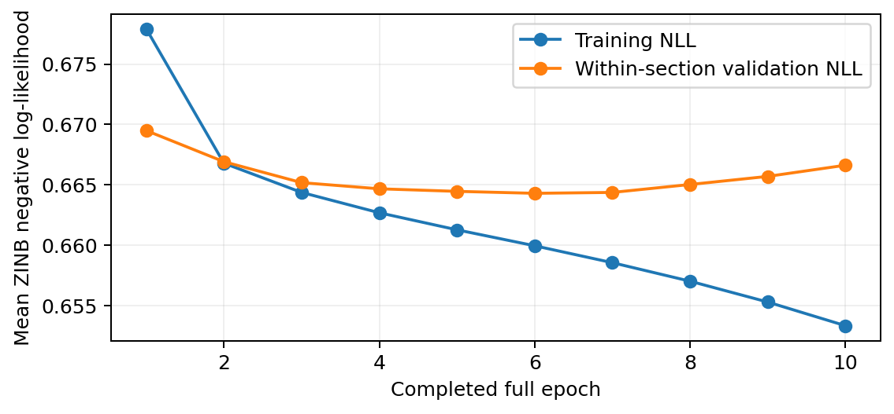
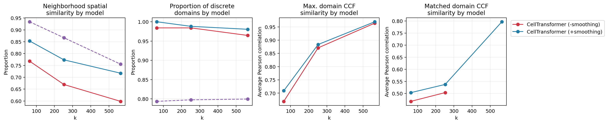
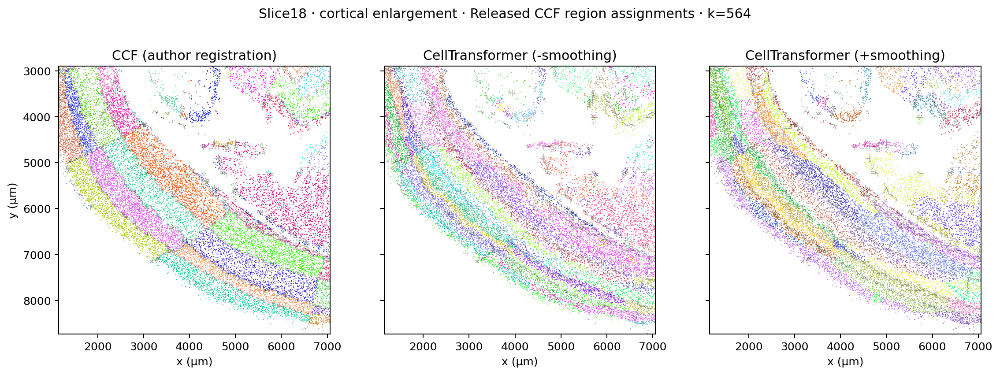

# Recorded BARseq result — 21 September 2026

These are selected **real outputs**, extracted from the user's downloaded
`results.zip` after the completed cactus run and the reference-color refresh.
They are not outputs from the synthetic CPU tests. `provenance.json` records
archive member names, SHA256 values and any path-only transformations.

| Item | Observed result |
|---|---:|
| Retained cells | 1,161,387 |
| Sequencing targets | 106 |
| Sections / mice | 40 / 1 hemisphere from 1 mouse |
| Eligible / exported centers | 1,161,154 |
| Training / validation centers | 1,103,095 / 58,059 |
| Completed epochs / optimizer updates | 10 / 49,287 |
| Final training NLL | 0.653343 |
| Final validation NLL | 0.666628 |
| Lowest validation NLL | 0.664303 at epoch 6 |
| Export checkpoint | Final completed epoch 10 |

Validation loss reached its minimum before the final epoch. The example retains
the requested final-checkpoint export; no claim of optimal stopping is made.

At the finest reference resolution (k=564), the smoothed model had neighborhood
spatial similarity **0.717117**, discrete-domain proportion **0.980496**, maximum
composition correlation **0.969421** and complete matched correlation **0.797023**.
These values describe this exploratory run, not a general performance guarantee.

The unsmoothed k=564 result has **561 populated domains on the evaluation mask**,
so its complete one-to-one matched correlation is undefined. The blank entry in
`fig2_metrics.tsv` is intentional; it is not silently filled or dropped.

Each anatomical label, including individual layers, has a separate color. This
changes visualization only. Model and reference colors are independently assigned.

`run_configuration.json`, `training_summary.json` and `data_summary.json` retain
numeric settings and results while replacing machine-specific storage prefixes
with `${RUN}` and `${BARSEQ_ROOT}`. The actual dependency records are in
`../environment/`. Full counts, embeddings, weights, the approximately 394-MB HTML
and the approximately 603-MB ZIP are excluded from Git. Run the example to create
a complete local report for all sections and resolutions.

Derived result artifacts are shared under CC BY 4.0; cite Chen, Fischer and
colleagues' BARseq deposit and paper, the CellTransformer work, and this example.
See the repository's `THIRD_PARTY_NOTICES.md`.
