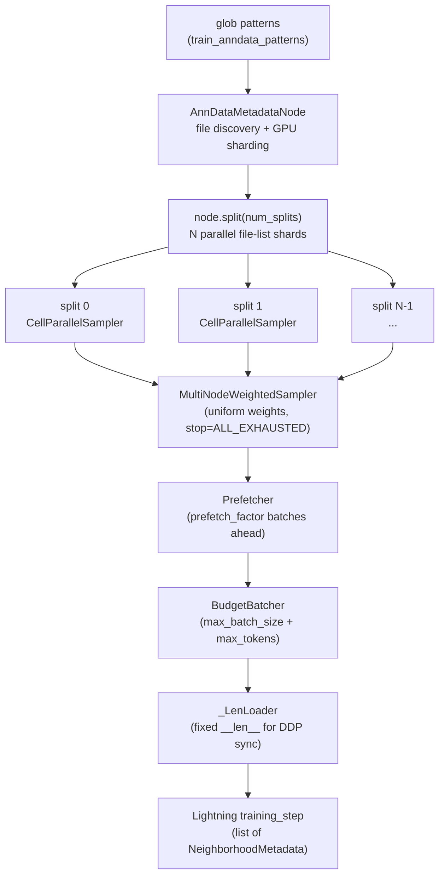
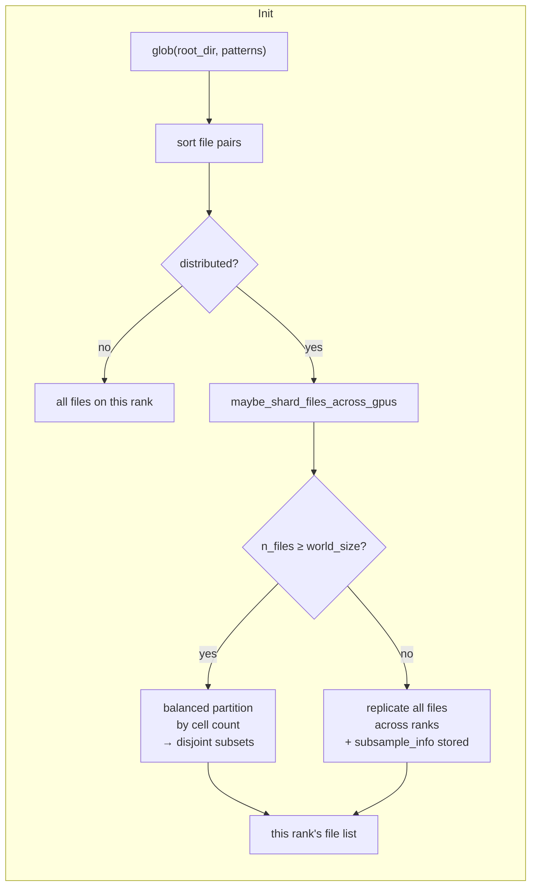
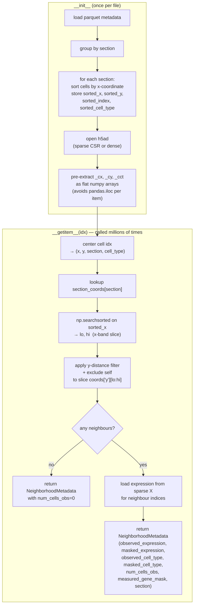
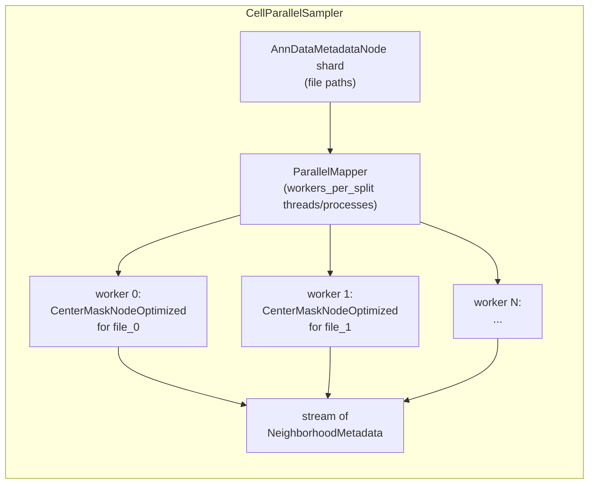
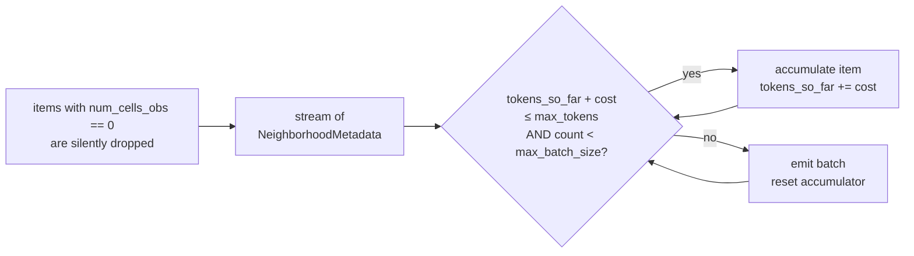
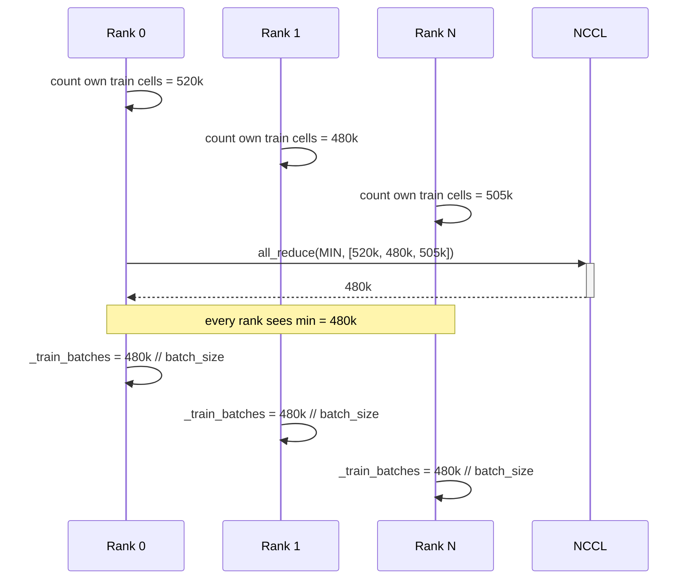

# celltransformer

Spatial cell expression prediction for MERFISH (spatial transcriptomics) data from mouse brain tissue.
A transformer-based model predicts gene expression of masked cells from their spatial neighbourhood context,
outputting Zero-Inflated Negative Binomial (ZINB) distribution parameters.

---

## Table of Contents

1. [Overview](#overview)
2. [Installation](#installation)
3. [Repository layout](#repository-layout)
4. [Configuration](#configuration)
5. [Scripts / Entry points](#scripts--entry-points)
   - [train](#celltransformer-train)
   - [extract](#celltransformer-extract)
   - [infer](#celltransformer-infer)
   - [preprocess](#celltransformer-preprocess)
   - [cluster](#celltransformer-cluster)
   - [smooth](#celltransformer-smooth)
6. [Data format](#data-format)
7. [Model architecture](#model-architecture)
8. [Data loading pipeline](#data-loading-pipeline)
   - [High-level pipeline](#high-level-pipeline)
   - [File discovery and GPU sharding](#file-discovery-and-gpu-sharding-anndatametadatanode)
   - [Neighbourhood extraction — the sorted-x trick](#neighbourhood-extraction-centermasknodeoptimized)
   - [Parallel sampling](#parallel-sampling-cellparallelsampler)
   - [Budget batching](#budget-batching-budgetbatcher)
   - [DDP epoch-length synchronisation](#ddp-epoch-length-synchronisation)
9. [Cell-type label encoding](#cell-type-label-encoding)

---

## Overview

Representation learning on MERFISH tissue sections (also, possibly, spatial sequencing).

The idea is to use a masked-center-cell prediction paradigm to see whether we can generate a good representation. 

See [Alex Google Drive](https://drive.google.com/drive/folders/1B8aHIxKfuhsgS_12XscTfvVUPFFxR79a?usp=sharing) for previous presentations ranging quite far back.

---

## Installation

```bash
# Requires: brainformr, scvi-tools (not on PyPI — install separately)
# GPU clustering additionally requires: cuml (RAPIDS)

git clone <repo-url>
cd celltransformer
pip install -e .
 
# or
pip install git+https://github.com/<rep-url>celltransformer.git
```

The package installs five console scripts (see [Entry points](#scripts--entry-points)).
Run using `python -m celltransformer.<subcommand>`.

---

## Repository layout

```
celltransformer/              ← git repo root  (pip install -e . from here)
├── src/
│   └── celltransformer/      ← Python package (src layout avoids namespace conflicts)
│       ├── model/            ← SpatialCellTransformer, split by component
│       |    ...blocks...            
│       ├── loader/           ← MERFISH data pipeline, split by concern
│       │   ├── _types.py         NeighborhoodMetadata + utility functions
│       │   ├── _node.py          AnnDataMetadataNode (file discovery + GPU sharding)
│       │   ├── _dataset.py       CenterMaskNodeOptimized (dynamic neighbourhood extraction over spatial radii); also the old CenterMaskNode for reference
│       │   ├── _sampler.py       CellParallelSampler, BudgetBatcher
│       │   └── _datamodule.py    MERFISHDataModule (Lightning DataModule)
│       ├── distributions/    ← Vendored NB / ZINB distributions (from scvi-tools)
│       ├── train/            ← Lightning training module + Hydra entry point
│       │   ├── main.py           Hydra entry point + SpatialTransformerModule, zinb_loss_log2, build_cell_type_int_map
│       │   └── __main__.py       stub
│       ├── extract/          ← Batch spatial-context embedding extraction → .npz
│       │   ├── main.py           CLI entry point + _build_cell_type_map, _load_model, _embed
│       │   └── __main__.py       stub
│       ├── infer/            ← Full inference (spatial + decoder tokens → obsm)
│       ├── preprocess/       ← Split multi-section h5ad into per-section files
│       │   ├── main.py           CLI entry point + Transform, find_metadata, split_sections, etc.
│       │   └── __main__.py       stub
│       ├── plotting.py       ← Shared spatial scatter-plot utility (make_section_plot)
│       ├── cluster/          ← cuML KMeans on embeddings + spatial scatter plots
│       │   ├── main.py           CLI entry point + _cluster_and_plot
│       │   └── __main__.py       stub
│       ├── smooth/           ← Gaussian spatial smoothing of embeddings (cuML kNN)
│       │   ├── main.py           CLI entry point + _gaussian_weights
│       │   └── __main__.py       stub
│       └── profile/          ← Cell-type composition profiling (KMeans or CCF regions)
│           ├── main.py           CLI entry point + build_contingency, load_taxonomy
│           └── __main__.py       stub
├── config/                   ← Hydra YAML configs (edit these, not the code)
│   ├── train_redone_registration.yaml
│   ├── data/
│   ├── model/
│   └── optimization/
├── pyproject.toml
└── setup.cfg
```

---

## Configuration

Training is configured entirely through Hydra YAML files in `config/`.
Override any value on the command line without editing files:

```bash
celltransformer-train data=scvi_sections model.dropout=0.1 optimization.lr=1e-4
```

Key config groups:

| Group | Description |
|---|---|
| `data` | Dataset paths, patterns, patch size, cell-type column | 
| `model` | Architecture, hyperparameters |
| `optimization` | LR, schedule, precision, epochs |

Top-level keys: `checkpoint_dir`, `wandb_project`, `model_checkpoint` (resume path), `save_top_k`.
When you are setting up the dataloader make sure that the size dimension of your patch size matches the provided spatial dimensions. 

The one important key that is not controlled by `hydra` right now is the GPU's--sorry!

---

## Scripts / Entry points

### `celltransformer-train`

```bash
celltransformer-train                              # default config
celltransformer-train data=scvi_sections           # switch dataset
celltransformer-train model_checkpoint=/path/to/last.ckpt  # resume
```

Trains the model using Hydra config. Launches 8-GPU DDP by default (hardcoded device list).
Logs to Weights & Biases; saves timestamped checkpoints to `checkpoint_dir`.

---

### `celltransformer-extract`

```bash
celltransformer-extract /path/to/section.h5ad \
    --checkpoint-path /data2/alexlee/checkpoints_next/20260221_145016/last.ckpt \
    --cell-type-yaml  /data1/.../taxonomy/338_subclass_taxonomy.yaml \
    --cell-type-colname hrc_mmc_subclass_name \
    [--section-colname section] \
    [--patch-size 31] \
    [--output-dir /data2/alexlee/embeddings/] \
    [--device cuda:0] \
    [--batch-size 512] \
    [--dry-run]
```

Embeds every cell in one `.h5ad` file (AttentionPool output only).
Output: `{output_dir}/{stem}_embeddings.npz` with arrays `embeddings` (float32, N×model_dim) and `has_neighbors` (bool, N).
`has_neighbors` is necessary because sometimes you will get a lone-cell (no neighbors) and the model currentl cannot operate on such cells.
In future it would be easy to simply use a passthrough operation (no update) in the transformer layers for decoding a cell with no spatial context, or to use a symbolic "no neighbors" token, but I have not tried it yet and the code will error if you don't have any neighbors provided for a generic cell. 
Therefore, we need to index out those rows when we are evaluating the embeddings.
Resumable: skips files whose `.npz` already exists.
The yaml file needs to be a flat yaml with no hierarchy that simply loads the full list of cell type names. 
If you provide this file it needs to correspond exactly to the cell type column unique entries in the `cell-type-colname` argument.

For parallel processing across multiple GPUs with GNU parallel:

```bash
find /path/to/sections/ -name '*.h5ad' | \
  parallel -j 4 --line-buffer \
    'celltransformer-extract {} \
         --checkpoint-path ... \
         --cell-type-yaml  ... \
         --cell-type-colname ... \
         --device cuda:$(({%} - 1)) \
         --output-dir /data2/alexlee/embeddings/'
```

---

### `celltransformer-preprocess`

```bash
# Dry-run: list sections and cell counts
celltransformer-preprocess INPUT.h5ad --output-dir OUT/ --dry-run

# Split all sections, transforming .layers['raw'] to log2(1+x) in .X
celltransformer-preprocess INPUT.h5ad --output-dir OUT/ --transform log2p1

# Filter QC-failed cells first
celltransformer-preprocess INPUT.h5ad --output-dir OUT/ \
    --transform log2p1 \
    --qc-col scvi_qc_passed_sup_level
```

Splits a multi-section `.h5ad` + paired `.parquet` into per-section file pairs.
For whatever reason, the Allen in the past often packaged their data as `AnnData` with relatively little metadata in the `.obs`, instead providing much of the metadata as a separate table.
More recently they have been giving me regular `AnnData` objectives from the `S3` but the current assumed filesystem is that the metadata and the counts `AnnData` are segmented, and the training code in particular assumes you are log base 2 for the computation of counts from the `NegativeBinomial` distributions.
The critical positional-alignment invariant (row i in parquet == row i in `adata.X`) is preserved.

Options: `--section-col` (default `section`), `--obs-id-col` (for row-count mismatches),
`--transform {log1p,log2p1}`, `--output-stem`, `--qc-col`, `--dry-run`.

---

### `celltransformer-cluster`

```bash
# Single specimen, two k values
celltransformer-cluster \
    --embeddings-dirs /data2/alexlee/embeddings/638850 \
    --data-dir /data1/.../sections/ \
    --ks 100 --ks 1000 \
    --tag 638850 \
    --output-base /data2/alexlee/embeddings/

# Two specimens concatenated before clustering
celltransformer-cluster \
    --embeddings-dirs /data2/alexlee/embeddings/638850 \
    --embeddings-dirs /data2/alexlee/embeddings/687997 \
    --tag 638850_687997 \
    --ks 100 --ks 1000
```

Requires `cuml` (RAPIDS GPU KMeans). Loads all `*_embeddings.npz` files once,
runs KMeans for each k, saves labels as `.npy`, then renders per-section spatial scatter plots.
See `celltransformer.plotting.make_section_plot` for more details. 

---

### `celltransformer-smooth`

```bash
celltransformer-smooth /path/to/metadata.csv \
    /path/to/embeddings.pt \
    /path/to/smoothed_output.pt \
    --gaussian-kernel 100 \
    --n-neighbors 500 \
    [--spatial-x-col x] \
    [--spatial-y-col y] \
    [--section-col section]
```

Gaussian spatial smoothing of cell embeddings. For each tissue section, builds a
GPU-accelerated approximate kNN graph on (x, y) coordinates (via cuML), computes
Gaussian-weighted averages of neighbor embeddings, and writes the smoothed
embeddings to a `.pt` file.

Requires `cuml` (RAPIDS). Use the `bfm_cml` conda environment.

---

## Data format

Each dataset section is a **paired `.h5ad` + `.parquet`** (or `.csv`) with the same filename stem.

| File | Contents |
|---|---|
| `.h5ad` | AnnData; `.X` = log2(1+counts) float32; optionally `.layers['raw']` for raw counts |
| `.parquet` | Per-cell metadata: `x`, `y`, `section`, cell-type column, optional QC columns |

**Important cell identity requirement:** row `i` in the parquet == row `i` in `adata.X`. Never reorder one without the other.

**Cell-type columns** (current scVI-based mapping):

| Column | Description |
|---|---|
| `RF_2lvl_consensus_subclass` | Subclass label string (used as cell-type input) |
| `RF_2lvl_consensus_class/supertype/cluster` | Other hierarchy levels |
| `RF_2lvl_consensus_subclass_prob` | Mapping confidence |
| `scvi_qc_passed_sup_level` | Boolean QC pass flag |

Resample the spatial coordinates to the range that you need, just make sure they are congruent with the patch sizes you pass to the dataloaders. 
A helpful rule of thumb is that the mouse's brain is about 1140um (coronal width/medial-lateral) wide, 800 um tall (superior-inferior), and 1320um long (anterior-posterior) in the Allen Atlas, so you can inspect the `x/y/z` values to determine a correct scaling factor.

---

## Model architecture

```
Observed neighbours (n_obs × n_genes) + cell types
        │
        ▼
  CellEmbedder (expression MLP + cell-type embedding → model_dim)
        │
        ▼
  TransformerEncoder × encoder_depth   (pre-norm, SwiGLU FFN)
  [operates on nested jagged tensors — variable-length neighbourhoods]
        │
        ▼
  AttentionPool  →  spatial_context  (1 × model_dim per cell)
        │
        ┌──────────────────────────────┐
        │   [spatial_context, decoder_cell_type_embed]  (2-token sequence)
        ▼
  TransformerEncoder × decoder_depth
        │
        ▼  token[1]  (cell-specific prediction token)
  ZINBProj  →  {mu, theta, zi_logits, scale}  (n_genes each)
        │
        ▼
  ZINB NLL loss vs. ground-truth log2(1+counts)
```

Key design choices:
- **Concat mode `add`**: expression embedding and cell-type embedding are summed (not concatenated).
- **`DiagonalNormalization`**: per-gene learnable scale + bias applied before the expression MLP — effectively a learnable input normalisation.
- **Nested jagged tensors (NJT)**: the encoder runs on PyTorch NJTs so variable-length neighbourhoods are packed without padding.
- **Decoder uses 2-token cross-attention**: the learned spatial context and the masked cell's type embedding are treated as a 2-element sequence; token[1]'s output drives the ZINB head.

---

## Data loading pipeline

### High-level pipeline



Inside each `CellParallelSampler`, `workers_per_split` worker threads run
`CenterMaskNodeOptimized` instances in parallel, each loading a file from the shard
and streaming `NeighborhoodMetadata` items.

---

### File discovery and GPU sharding (`AnnDataMetadataNode`)

`AnnDataMetadataNode` discovers all `(h5ad, parquet)` pairs matching the glob patterns, (perhaps something like "*638850*h5ad", for example, for mouse 638850)
then shards the file list across GPU ranks so each rank owns a disjoint subset of files.



**`_greedy_binpack_partition`**: when `n_files ≥ world_size`, files are sorted by descending
cell count and assigned greedily to the lightest rank (min-heap). On the scvi dataset
(101 train sections, 8 GPUs) this produces a max−min spread of ~0.9%, vs ~12.9% with
naive round-robin. Since training stops at the min-rank (`all_reduce(MIN)`), tighter
packing means more cells seen per epoch across all ranks.

**Replication fallback**: when there are fewer files than GPU ranks (e.g., 3 files on 8 GPUs),
every rank gets all files but `CellParallelSampler` subsamples each rank to `1/world_size`
of the cells so the total work stays the same.

---

### Neighbourhood extraction (`CenterMaskNodeOptimized`)

This is the performance-critical path. A naive spatial lookup (filter all cells by distance)
is O(n) per query. Instead, coordinates are **pre-sorted by x at init time**, reducing
each query to O(log n + k) where k is the neighbourhood size.



**Why x-sorting works**: MERFISH tissue sections are 2-D. Sorting by one axis (x) and binary-searching
gives a narrow band of candidates; the y filter then eliminates the remainder. For a typical
`patch_size=[31, 31]` on a section with ~100 k cells, the x-band contains ~0.03% of all cells,
so the y loop is tiny.

**Expression access dispatch** (`idx_to_expr`): at init, the dataset detects whether `adata.X`
is sparse or dense and binds the appropriate fetch method once, avoiding the `isinstance` check
on every `__getitem__` call.

---

### Parallel sampling (`CellParallelSampler`)



Each worker holds **one file** in memory at a time (h5ad + parquet).
`workers_per_split` controls the parallelism; `multiprocessing_method='thread'`
is the default because anndata's sparse reads release the GIL.

---

### Budget batching (`BudgetBatcher`)

Standard batching groups exactly `batch_size` items. The problem: neighbourhoods vary
from 0 to ~hundreds of cells, so a fixed-count batch has wildly variable memory footprint —
leading to OOM errors or under-utilisation.

`BudgetBatcher` batches by **token count** instead:

```
token_cost(item) = item.num_cells_obs + 1
```



`max_tokens` (default 200 000) is the primary constraint; `max_batch_size` (default 256) is
a secondary cap. In practice `max_tokens` is the binding constraint for large neighbourhoods.

---

### DDP epoch-length synchronisation

The hardest operational problem in multi-GPU training is ensuring all ranks stop at the same step.
If rank 0 has 10 000 more cells than rank 7, rank 7 finishes first and the NCCL collective hangs.

Two mechanisms prevent this:

**1. `_LenLoader` — shared epoch length**

Lightning calls `len(dataloader)` to know when to stop. After `setup()`, an `all_reduce(MIN)`
across ranks finds the minimum cell budget, computes a shared `n_batches = min_cells / batch_size`,
and `_LenLoader` wraps the torchdata pipeline to report that length to Lightning.



**2. Per-split cell budget**

`max_total_cells` (from sharding) is divided across `num_splits` so that each split node
processes at most `max_total_cells / n_splits` cells. Without this, a rank with more files
would process proportionally more cells through N independent splits, inflating its effective
epoch length.

---

## Cell-type label encoding

The latest version of the Allen's taxonomy has:

| Hierarchy Type | Class | Subclass | Supertype | Cluster |
| :--- | :---: | :---: | :---: | :---: |
| **Standard** | 34 | 338 | 1,201 | 5,319 |
| **scVI-based** | 40 | 375 | 1,235 | 5,602 |

The earlier version (AIT28 [could be wrong on the number]) was constructed using heuristics to constrain hierarchical clustering. Clusters were merged based on DEGs and with some additional procedures around relative difference to other cell types. The newer version, AIT33, is constructed by adding both whole-brain snRNA-seq from Macosko lab's Langlieb / Nature / 2023 paper (anectdotally seems to have improved coverage of cerebellar cell types; I remember a comment from BT that within Allen's scRNA that perhaps microglia and astrocytes could have been resolved to greater depth), and using scVI. I don't know very much about whether similar heuristics were applied here within the scVI latent space, although I'm sure it could be found out by messaging Michael Kunst. 

## Known issues

### GPU vs CPU embedding extraction

Embeddings extracted on GPU and CPU will **not be identical** due to different SDPA (Scaled Dot-Product Attention) backend selection:

- [PyTorch SDPA docs — backend selection and dtype constraints](https://docs.pytorch.org/docs/stable/generated/torch.nn.functional.scaled_dot_product_attention.html)
- [PyTorch SDPA tutorial — comparing backends](https://docs.pytorch.org/tutorials/intermediate/scaled_dot_product_attention_tutorial.html)
- [GitHub #119131 — Math backend NaN with float16 mixed precision](https://github.com/pytorch/pytorch/issues/119131)
- [GitHub #151912 — bfloat16 numerical errors for Math backend under torch.compile](https://github.com/pytorch/pytorch/issues/151912)

